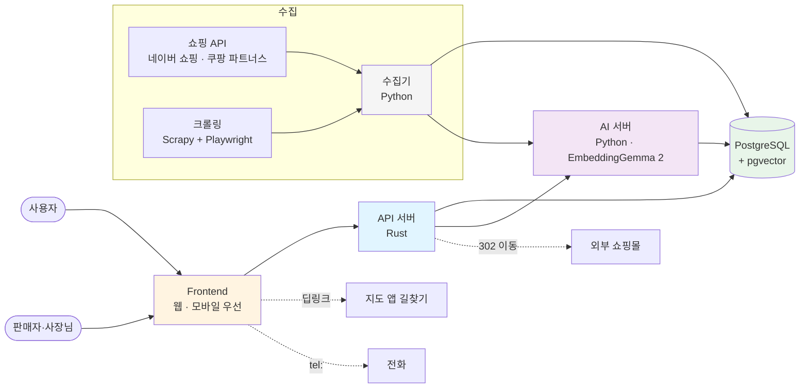
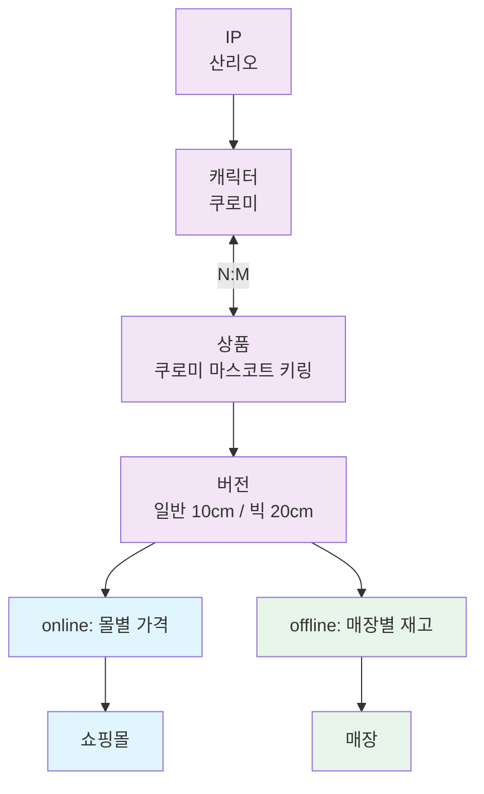
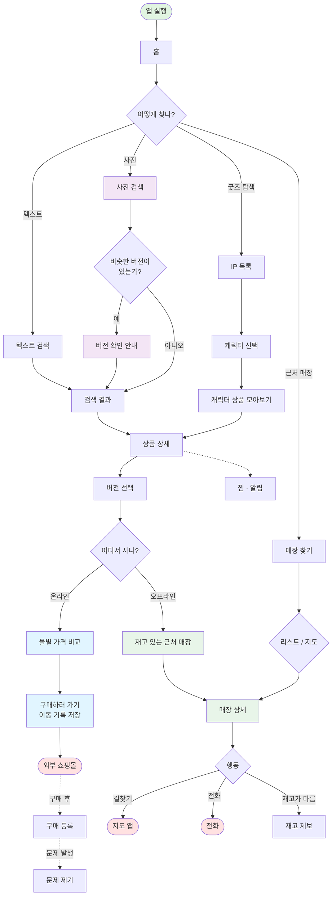

# 굿모닝 (굿즈 모으는 닝겐)

캐릭터 굿즈를 IP·캐릭터 단위로 모아 보고, 같은 상품의 온라인 최저가와 근처 오프라인 매장 재고를 한 화면에서 확인하는 서비스.

UST AI 응용을 위한 UX 설계 · 팀 에뚜리들 (김상우, 임상원, 전하린)

## 배경

### 사용자 조사 결과

설문 10명, 행동 관찰 3명, 인터뷰 4명.

|조사 결과|반영할 기능|
|--|--|
|가장 많이 이용하는 구매 경로가 오프라인 6/10|매장 찾기 (리스트·지도), 재고 상태, 길찾기·전화|
|판매처·재고 확인이 어려웠던 경험 9/10|온라인/오프라인 배지, 재고 확인 시각·출처 표시|
|"사이트를 여러 개 띄워 두고 하나하나 비교하기 힘듦" (인터뷰 C)|같은 상품을 묶은 온라인 가격 비교|
|"한 캐릭터의 피규어, 키링, 인형을 한꺼번에 볼 수 있어 좋았음" (인터뷰 B·C)|IP → 캐릭터 단위 분류|
|사진 검색 후 다른 버전(미니) 선택 2/3|이미지·텍스트 임베딩 검색 + 버전 구분 표시|
|중고 구매 경험 0/4, 리셀러·후원 단절에 대한 거부감|중고 거래 제외, 공식 굿즈 판매처 중심|

### 방향 전환

이전 단계 프로토타입([etturideul](https://github.com/bloodmoon3929/etturideul))은 중고 매물 추천이었다.
조사 결과 사용자는 중고보다 새 상품을 어디서 살 수 있는지를 더 어려워했기 때문에, 굿모닝은 공식 굿즈 판매처(온라인 몰 + 오프라인 매장) 탐색으로 범위를 바꾼다.

## 진행 순서

|단계|산출물|위치|
|--|--|--|
|1. 명세|전체 기능·요구사항 명세 (이 문서)|`README.md`|
|2. UI|화면 설계 (PPT 또는 Figma) + 화면 명세|`frontend/`|
|3. 백엔드 명세|UI의 버튼·화면별 API, 배치 작업, DB 설계|`backend/`|
|4. 목업·구현|목업 데이터, 클릭 가능한 프로토타입|`frontend/`, `backend/`|

> 각 단계는 앞 단계가 확정된 뒤 시작한다. 단계 3은 단계 2의 화면 명세에 있는 버튼 하나하나를 기준으로 작성한다.

## 프로젝트 구조

```text
goodmorning/
├── README.md              # 전체 명세 (이 문서)
├── frontend/
│   ├── README.md          # 화면 명세: 화면별 구성 요소, 버튼, 상태
│   └── design/            # PPT·Figma 결과물, 화면 캡처
└── backend/
    ├── README.md          # API 명세, 배치 작업, DB 설계
    ├── api/               # Rust API 서버
    ├── ai/                # Python AI 서버 (임베딩·검색·상품 매칭)
    ├── collector/         # Python 수집기 (쇼핑 API, Scrapy + Playwright)
    └── db/                # PostgreSQL 스키마
```

> `backend/` 하위 폴더는 단계 4에서 만든다.

## 시스템 구성

### 계층별 책임

|계층|기술|책임|예시|
|--|--|--|--|
|Frontend|웹 (모바일 우선)|화면 표시, 사용자 입력|배지 필터, 지도·리스트 전환|
|API 서버|Rust|요청 처리, 권한 확인, DB 조회·저장|상품 상세, 재고 제보 저장|
|AI 서버|Python, EmbeddingGemma 2|이미지·텍스트 임베딩, 유사도 검색, 상품 매칭|사진 검색, 판매자 상품 등록 시 후보 제시|
|수집기|Python, Scrapy + Playwright|외부 몰·매장 정보 수집|쇼핑 API 가격 수집, 공지 페이지 크롤링|
|DB|PostgreSQL + pgvector|데이터 저장, 벡터 유사도 검색|가격, 재고, 임베딩|

### 구성도



### 데이터 구분

온라인 데이터와 오프라인 데이터는 PostgreSQL의 스키마를 나누어 따로 저장한다.
두 쪽이 같은 상품을 가리켜야 비교할 수 있으므로 상품 카탈로그는 공통 스키마에 둔다.

|스키마|내용|예시|
|--|--|--|
|`catalog`|공통 상품 정보|IP, 캐릭터, 상품, 버전(variant), 임베딩|
|`online`|온라인 판매 정보|쇼핑몰, 몰별 가격·배송비, 수집 시각|
|`offline`|오프라인 판매 정보|매장, 매장별 재고 상태, 확인 시각, 재고 제보|
|`account`|사용자·판매자|회원, 찜, 알림, 이동 기록, 구매 기록, 문의, 판매자 계정|
|`ingest`|수집 원본|수집한 원본 상품 정보, 매칭 대기 목록|



> 가격과 재고는 버전(variant) 단위로 관리한다. 같은 상품이라도 크기·차수가 다르면 가격과 재고가 다르고, 사진 검색에서 버전 혼동이 확인되었기 때문이다.
> 상품과 캐릭터는 N:M 관계다. 콜라보·단체 굿즈는 캐릭터가 여럿이다.

## 핵심 기능

1. 온라인/오프라인 구분
- 상품마다 온라인·오프라인 배지 표시
- 전체 / 온라인 / 오프라인 필터

2. 온라인 가격 비교
- 같은 상품의 여러 쇼핑몰 가격을 한 목록으로 비교
- 배송비 포함 총액 기준 정렬
- 외부 몰로 이동

3. IP·캐릭터 분류
- IP → 캐릭터 → 상품 순서로 탐색
- 캐릭터 단위로 피규어·인형·키링 등을 모아 보기

4. AI 검색
- 텍스트 검색, 사진 검색
- EmbeddingGemma 2 이미지·텍스트 임베딩의 코사인 유사도
- 비슷한 버전이 있으면 버전 확인 안내

5. 오프라인 매장 찾기
- 리스트 뷰, 지도 뷰
- 매장 정보, 재고 상태, 재고 확인 시각·출처
- 길찾기, 전화걸기

6. 정보 수집
- 쇼핑 API, 크롤링, 판매자 직접 등록, 사용자 제보

7. 사용자 기록
- 찜, 알림, 외부 몰 이동 기록, 구매 기록, 문제 제기

8. 판매자 센터
- 매장·몰 정보 관리, 재고 관리, 상품 등록, 제보 확인

## 사용자 흐름



## 요구사항

### 기능 요구사항

- [ ] 온라인/오프라인 배지
> 상품 카드에 판매 경로를 배지로 표시한다.
> 온라인 배지: 판매 몰 수, 배송비 포함 최저 총액 (예: `온라인 4곳 · 최저 12,900원`)
> 오프라인 배지: 근처 재고 있는 매장 수 (예: `근처 2곳 재고`)
> 판매 경로가 없는 쪽 배지는 표시하지 않는다.
- [ ] 판매 경로 필터
> 전체 / 온라인 / 오프라인 중 하나를 선택한다.
> 선택한 필터는 홈, 검색, 굿즈 탐색 목록에 모두 적용된다.

- [ ] 온라인 가격 비교
> 같은 버전(variant)의 몰별 판매 정보를 한 목록에 보여준다.
> 각 행: 몰 이름, 상품가, 배송비, 총액, 수집 출처, 수집 시각, 품절 여부
> 기본 정렬은 총액 오름차순이다.
- [ ] 외부 몰 이동
> [구매하러 가기]를 누르면 클릭 시점의 몰·가격·배송비를 이동 기록으로 저장한 뒤 외부 몰로 이동한다.
> 실제 결제는 외부 몰에서 일어나므로, 이동 기록이 구매 추적과 문의 확인의 기준이 된다.

- [ ] 굿즈 탐색
> IP 목록 → IP 선택 → 캐릭터 목록 → 캐릭터 선택 → 상품 목록 순서로 이동한다.
> 상품 목록은 품목(피규어, 인형, 키링, 아크릴, 프라모델, 랜덤)으로 거를 수 있다.
> IP는 별칭으로도 찾을 수 있다. (예: 먼작귀 → 치이카와)
- [ ] 관심 IP
> IP를 관심 등록하면 홈 바로가기 맨 앞에 보인다.

- [ ] 텍스트 검색
> 키워드 일치와 텍스트 임베딩 유사도를 함께 사용한다.
> 검색어는 IP·캐릭터 별칭 사전으로 확장한다.
- [ ] 사진 검색
> 업로드한 사진의 이미지 임베딩과 상품 임베딩의 코사인 유사도로 후보를 찾는다.
> 같은 상품의 다른 버전이 상위 후보에 함께 있으면 `버전 확인` 안내를 보여준다.
> 텍스트 조건(예: `미니`, `박스 ver.`)을 추가로 입력할 수 있다.

- [ ] 상품 상세
> 상품 이미지, IP·캐릭터, 버전 목록, 온라인/오프라인 요약을 보여준다.
> 버전을 바꾸면 가격 비교와 매장 재고가 그 버전 기준으로 바뀐다.
> 비슷한 상품을 보여주되, 한 IP에 쏠리지 않도록 IP별 개수를 제한한다.
- [ ] 찜
> 버전 단위로 찜한다.
- [ ] 알림
> 목표가 이하 / 재입고 / 근처 매장 입고 중 하나를 선택해 등록한다.

- [ ] 매장 찾기
> 리스트 뷰와 지도 뷰를 전환할 수 있다. 두 뷰는 같은 결과를 표시만 다르게 한다.
> 리스트 뷰는 거리순으로 정렬한다.
> 지도 뷰는 재고 상태에 따라 마커 색을 다르게 표시한다.
> `재고 있는 매장만` 필터를 제공한다.
> 기간 한정 팝업스토어는 종료일을 함께 표시한다.
- [ ] 매장 상세
> 매장 이름, 매장 유형, 주소, 영업시간, 전화번호, 취급 상품 재고를 보여준다.
> 재고마다 상태(많음 / 적음 / 없음 / 확인 필요), 확인 출처(사장님 / 제보 / 수집), 확인 시각을 표시한다.
- [ ] 길찾기
> 지도 앱으로 연결한다. 백엔드를 거치지 않는다.
- [ ] 전화걸기
> 전화 앱으로 연결한다. 백엔드를 거치지 않는다.
- [ ] 재고 제보
> 매장, 상품 버전, 재고 상태, 사진(선택)을 받아 검토 대기 상태로 저장한다.
> 판매자가 승인하면 반영한다.
> 판매자가 없는 매장은 서로 다른 사용자 2명이 같은 내용을 제보하면 반영한다.
- [ ] 매장 제보
> 새 매장, 주소·영업시간 변경, 폐업을 제보할 수 있다. 관리자 검토 후 반영한다.

- [ ] 구매 등록
> 이동 기록에서 [구매했어요]로 등록하거나, 오프라인 구매를 직접 입력한다.
- [ ] 문제 제기
> 구매 기록 또는 이동 기록을 선택해 문의한다.
> 문의 유형: 가격이 달랐어요 / 재고가 없었어요 / 가품 의심 / 기타
> 운영자는 클릭 시점 가격 스냅샷과 현재 가격을 함께 확인한다.

- [ ] 판매자 계정
> 판매자 계정은 자기 매장·몰에 연결되며, 자기 매장·몰의 정보만 수정할 수 있다.
- [ ] 재고 관리
> 상품 버전별 재고 상태를 한 화면에서 바꾸고 한 번에 저장한다.
> [오늘 재고 그대로예요] 버튼은 상태를 유지한 채 전 품목의 확인 시각만 갱신한다.
- [ ] 상품 등록
> 사진(+상품명)을 올리면 AI가 카탈로그에서 같은 상품 후보 3개를 보여준다.
> 후보를 고르면 그 버전을 내 매장 취급 상품으로 추가한다.
> 후보에 없으면 새 상품을 요청하고, 관리자 검토 후 카탈로그에 추가한다.
- [ ] 제보 확인
> 내 매장에 들어온 재고 제보를 승인하거나 반려한다. 결과는 제보자에게 알린다.

- [ ] 정보 수집
> 우선순위: 쇼핑 API → 판매자 직접 등록 → 크롤링 → 사용자 제보
> 수집한 원본은 바로 노출하지 않고, 카탈로그 버전과 매칭된 것만 노출한다.
> 매칭이 애매하면 검토 대기 목록에 넣는다.
- [ ] IP·캐릭터 자동 분류 제안
> 분류되지 않은 상품은 임베딩 군집으로 IP·캐릭터 후보를 제안하고, 관리자가 확정한다.

### 예외 상황

- [ ] 재고 정보가 오래된 경우
> 확인한 지 48시간이 지난 재고는 `확인 필요`로 표시한다.
- [ ] 검색 결과가 없는 경우
> 비슷한 IP·캐릭터를 추천하고, 상품 제보 버튼을 보여준다.
- [ ] 사진에서 상품을 찾지 못한 경우
> 유사도가 기준값 미만이면 결과 대신 텍스트 조건 입력을 안내한다.
- [ ] 위치 권한을 거부한 경우
> 기본 지역(서울시청)을 기준으로 보여주고, 지역을 직접 고를 수 있게 한다.
- [ ] 외부 몰에서 품절된 경우
> 품절 행은 목록 맨 아래에 회색으로 표시하고 [구매하러 가기]를 막는다.
- [ ] 판매 경로가 하나도 없는 상품
> 상품 상세에 `현재 판매처 없음`을 표시하고, 재입고 알림을 권한다.
- [ ] 수집이 실패한 경우
> 이전 값을 유지하고, 수집 시각은 갱신하지 않는다.

### 프로그래밍 요구사항

1. 프론트엔드는 모바일 화면을 우선으로 설계한다. (행동 관찰 참여자 중 모바일 사용자는 목록 탐색 위주로 사용)
2. API 서버는 Rust, AI 서버와 수집기는 Python으로 작성한다.
3. DB는 PostgreSQL을 사용하고, 임베딩은 pgvector로 같은 DB에 저장한다.
4. 모든 가격·재고 데이터에는 출처(`api` / `crawl` / `owner` / `report`)와 확인 시각을 저장한다.
5. 크롤링은 robots.txt와 이용약관에서 허용한 범위에서만 한다.
6. 사용자의 현재 위치는 매장 검색에만 쓰고 저장하지 않는다.
7. 프로토타입의 매장·가격·전화번호는 모두 가상 데이터를 사용한다.
8. 결제와 중고 거래는 범위에서 제외한다.

## 커밋 컨벤션

`type(scope) : 메시지` 형식으로 작성한다.

|type|용도|예시|
|--|--|--|
|docs|명세·문서|`docs(README) : 기능 요구사항 작성`|
|design|UI 설계 결과물|`design(home) : 홈 화면 와이어프레임 추가`|
|feat|기능 구현|`feat(search) : 사진 검색 API 구현`|
|fix|버그 수정|`fix(store) : 지도 마커 색 오류 수정`|
|refactor|동작 변화 없는 구조 변경|`refactor(api) : 재고 조회 쿼리 분리`|
|test|테스트|`test(ai) : 임베딩 유사도 테스트 추가`|
|chore|설정·기타|`chore : .gitignore 추가`|
