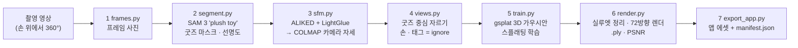

# backend/ai/asset3d — 굿즈 360° 영상 → 3D 에셋 (앱 '내 방')

손에 들고 한 바퀴 돌려 찍은 굿즈 영상 하나로 3D 가우시안 스플래팅 에셋을 만들고, 앱 '내 방' 탭이 쓰는 그림 · 정보(`frontend/assets/room/<id>/`)를 내보낸다.
GPU(CUDA)가 있는 PC에서 미리 돌리는 오프라인 작업이다. 앱 안에서 바로 계산하지 않는다.



## 촬영 — 가우시안 스플래팅이 잘 되게

처음 영상(손에 들고 돌림)은 손이 가리고 인형이 눌려서 결과가 거칠었다. 다시 찍을 때는 앱 '내 방' → [내 굿즈 직접 촬영하기]의 자동 촬영 가이드를 쓴다.

- 굿즈는 손에 들지 않고 받침(무늬 있는 종이 등) 위에 세운다. 휴대폰을 들고 둘레를 돈다
- 원 안에 굿즈가 꽉 차게, 도는 동안 같은 거리
- 높이 3줄(카메라가 아래로 낮게 −5~20° · 중간 20~45° · 높게 45~75°) × 방향 24칸(15°) = 72장. 아직 안 찍은 칸에서 휴대폰이 멈추면(초당 25° 이하로 0.3초) 자동으로 찍는다 — 흔들린 사진이 들어가지 않게
- 밝고 고른 빛, 반사가 적은 곳
- [사진 받기] → `goodmorning-capture-….zip` (사진 + 칸마다 각도 `capture.json`) → 아래 `frames.py`에 그대로 넣는다

기울기는 웹에서는 DeviceOrientationEvent(아이폰은 [촬영 시작]을 누를 때 허락), 앱에서는 가속도 · 자이로(sensors_plus)로 잰다. 센서가 없는 데스크톱에서는 화면을 끌어서 각도를 흉내 내는 시연 모드가 된다.

## 실행

```bash
cd backend/ai/asset3d
# 저장소 경로에 공백이 있으면("04. UST/…") gsplat CUDA 컴파일의 링크가 깨진다 → 가상환경을 공백 없는 곳에
export UV_PROJECT_ENVIRONMENT=$HOME/.cache/goodmorning-asset3d-venv CUDA_HOME=/usr/local/cuda-12.8 PATH=/usr/local/cuda-12.8/bin:$PATH
uv sync                        # Python 3.12, torch 2.8 (CUDA 12.8), SAM 3, gsplat, kornia, pycolmap
hf auth login                  # SAM 3 가중치(facebook/sam3)는 접근 승인을 받은 계정이어야 받아진다
OUT=../../../frontend/assets/room/pochita
uv run python frames.py ../../../../20261123_091242.mp4    # → work/frames (앱 가이드 zip · 사진 폴더도 된다)
uv run python segment.py                                    # → work/masks, masks.json
uv run python sfm.py                                        # → work/sfm (가장 큰 모델: work/sfm/best.txt)
uv run python views.py --count 160                          # → work/views
uv run python train.py --steps 15000                        # → work/gaussians.pt
uv run python render.py --out $OUT --ply output/pochita.ply # → 회전 그림 72장, 3D 파일
uv run python export_app.py --out $OUT                      # → 촬영 · 분할 그림 36장씩, manifest.json
```

`work/` · `output/`은 저장소에 올리지 않는다. gsplat은 처음 실행할 때 CUDA 코드를 컴파일한다 (2분 안팎, `nvcc` 필요).

## 단계별로 한 일

|단계|하는 일|정한 것 · 이유|
|--|--|--|
|segment|프레임마다 SAM 3에 "plush toy"로 물어 가장 점수 높은 영역 1개|손 · 종이 태그는 이 프롬프트에 잡히지 않는다. 흐린 프레임을 거르려고 마스크 안 라플라시안 분산(선명도)도 잰다|
|sfm|마스크 안에서만 ALIKED 특징점 → LightGlue 매칭 → COLMAP 기하 검증 · 증분 복원|손으로 돌리면 배경은 굿즈와 따로 움직여서 굿즈만 보고 맞춘다 ("굿즈는 그대로, 카메라가 주위를 돈다"). 짝은 영상 순서로 가까운 10장 + 16 · 32장 뒤 + 8장마다 고른 프레임끼리 전부(한 바퀴 돌아 처음과 이어지게)|
|views|SfM에 들어간 프레임 중 160장을 고르게, 굿즈 중심 정사각형 512px. 배경은 흰색|자르면서 초점거리 · 중심점도 같이 옮긴다. SAM 3로 "hand" · "paper tag"도 찾아 굿즈를 가린 곳은 ignore|
|train|gsplat, 15,000번. 손실 = 색 L1 0.8 + SSIM 0.2 + 윤곽(alpha ↔ 마스크) 0.5, ignore는 빼고|ignore를 빼지 않으면 손이 가린 자리가 "비어 있음"으로 학습되어 구멍이 생긴다. 8장마다 1장은 학습에 안 쓰고 확인용|
|render|학습 사진에서 마스크 밖에 놓이는 비율이 25% 넘는 가우시안 · 너무 큰 조각을 지우고, 첫 프레임 카메라의 위쪽을 축으로 5°씩 72장|가장자리의 반투명 "지느러미" 같은 잡티를 줄인다. 확인용 사진은 정리에도 쓰지 않고 PSNR만 잰다|

## 이 영상의 결과 (20261123_091242.mp4, 포치타 인형)

|단계|결과|
|--|--|
|영상|15.8초, 120fps, 1,900프레임 (가로 720px로 뽑음)|
|SAM 3 분할|2프레임마다 950장 중 896장에서 인형을 찾음|
|SfM|흐린 프레임을 뺀 380장 중 375장이 한 모델로 이어짐 (재투영 오차 1.1px, 점 5,861개). 영상 처음과 끝이 이어져 한 바퀴|
|학습|160장 중 140장으로 15,000번, 가우시안 22.9만 개|
|정리 · 렌더|실루엣 검사로 15.4만 개 남김, 72방향 렌더. 확인용 20장 PSNR 정리 전 18.3dB → 정리 후 16.9dB|
|앱|`frontend/assets/room/pochita/` (촬영 · 분할 36장씩 + 회전 72장, 2.3MB), 3D 파일 `output/pochita.ply` (38MB, 저장소 제외)|

정면 얼굴 · 톱 · 꼬리는 알아볼 수 있지만, 옆 · 뒤 가장자리에 반투명 잡티가 남고 손에 닿았던 바닥은 거칠다. 같은 영상에서 SfM은 실행마다 조금씩 달라서 PSNR도 1~2dB 흔들린다 (앞선 시험 실행은 정리 후 18.9dB).

## 해 봤지만 쓰지 않은 것

|방법|결과|
|--|--|
|SAM 3D Objects (사진 한 장 → 3D)|Hugging Face `facebook/sam-3d-objects` 가중치가 접근 승인제이고, 2026-11-23 기준 이 계정으로 받으면 403(승인 전)이다. 실행 환경(`~/sam-3d-objects`, conda `sam3d-objects`: torch 2.5.1 + cu121, pytorch3d, kaolin, GPU 32GB 이상)은 미리 만들어 두고, 승인되면 같은 영상의 대표 사진 + SAM 3 마스크로 돌려 가우시안 스플래팅과 비교한다|
|VGGT로 카메라 추정|배경을 지운 굿즈 사진 120장에서 신뢰도가 거의 최저로 나왔고, 그 자세로 학습하니 확인용 PSNR 12.6dB로 모양이 깨졌다|
|COLMAP 기본(SIFT)|털 인형이라 특징점이 약해서 한 모델로 이어지지 않고 4조각(최대 76장, 회전 55°)으로 끊겼다|

## 다른 선택지

- [Gausify Orbit](https://github.com/obraia/gausify-orbit) (MIT): 브라우저(WebGPU)에서 둘레 영상 → 선명한 프레임 고르기 → SAM 2.1 · RMBG 분할 → 둘레 전용 SfM → 학습까지 하는 도구. 이 폴더와 같은 흐름이라, 같은 촬영본을 넣어 결과를 비교해 볼 수 있다 (CUDA 없이 데스크톱 Chrome)
- 파노라마(360°) 카메라: 장비를 사야 해서 이번에는 하지 않았다

## 한계

- 손바닥에 닿아 있던 바닥면과, 손으로 쥐어 눌린 부분은 덜 정확하다. 인형은 쥐면 모양이 조금 바뀌어서(딱딱한 물체가 아님) 가장자리에 잡티가 남는다
- 실제 크기(치수)는 모른다. 시안의 100원 동전 기준 사진은 이 영상에 없다
- 영상 하나로 만든 결과를 앱에 넣었다. 앱에서 찍어서 서버가 만드는 흐름은 아직 없다

## 쓴 것 · 라이선스

SAM 3 (Meta, SAM License — 가중치는 접근 승인 필요) · gsplat (Apache-2.0) · kornia ALIKED · LightGlue (Apache-2.0) · COLMAP / pycolmap (BSD-3-Clause) · PyTorch
