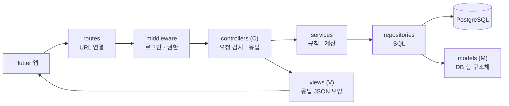

# backend/api — Rust API 서버 (MVC)

앱(Flutter)의 요청을 받아 DB를 읽고 쓰는 서버. 웹 프레임워크는 Axum, DB 접근은 sqlx를 생각하고 있다.
요청 하나는 항상 아래 순서로 흐른다.



```text
api/
├── src/
│   ├── routes/         # URL ↔ 컨트롤러 연결. 화면 명세의 버튼 하나 = API 하나 = route 한 줄
│   ├── middleware/     # 로그인 확인, 판매자 권한(본인 매장만), 요청 로그
│   ├── controllers/    # C: 입력 검사 → 서비스 호출 → view로 응답. SQL을 직접 쓰지 않는다
│   ├── services/       # 업무 규칙: 48시간 지난 재고는 확인 필요, 같은 제보 2건이면 반영, 배송비 포함 총액 정렬 …
│   ├── repositories/   # DB 접근만. sqlx 쿼리, 값은 매개변수로 넘긴다 (SQL 인젝션 방지)
│   ├── models/         # M: DB 테이블과 같은 구조체 (backend/db.md)
│   ├── views/          # V: 앱에 내려줄 JSON 모양 (화면에 필요한 필드만)
│   └── config/         # 환경 변수, DB 연결 설정
└── tests/
```

## 규칙

- 폴더는 기능별로 같은 이름의 파일을 둔다. 예: 재고 제보 → `routes/report.rs`, `controllers/report.rs`, `services/report.rs`, `repositories/report.rs`, `views/report.rs`
- controllers는 services만, services는 repositories만 부른다. 거꾸로 부르거나 건너뛰지 않는다.
- models(DB 모양)와 views(응답 모양)를 섞지 않는다. 비밀번호 해시 같은 DB 컬럼이 응답에 실수로 나가지 않게 하기 위해서다.
- DB 스키마 변경은 `backend/db/migrations/`에 SQL 파일로 남긴다.

> MVVM은 화면 쪽 패턴이라 Flutter의 화면별 view model에서 쓰고 (frontend/lib/README.md), 서버는 화면이 없으므로 응답 JSON을 View로 보는 MVC로 나눴다.
