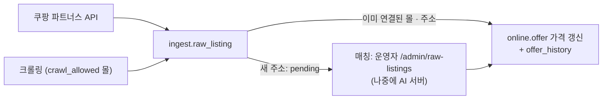

# backend/collector — Python 수집기

쇼핑 API와 크롤링으로 몰 정보를 모아 `ingest.raw_listing`에 저장한다. 앱에 보이는 것은 카탈로그 버전과 매칭된 뒤다.

```text
collector/
├── api_clients/        # 쇼핑 API: coupang.py (쿠팡 파트너스 Open API), python -m api_clients 로 실행
├── spiders/mall.py     # Scrapy + Playwright 크롤러 (online.mall.crawl_allowed = true 인 몰만)
├── pipelines/          # 크롤링 결과 → ingest.raw_listing, 몰마다 ingest.collect_job
├── db.py               # DB 접근 · 저장 규칙 (매칭된 판매처 가격 갱신)
├── listing.py          # 수집 결과 한 줄 (API · 크롤링 공통), 가격 · 배송비 읽기
├── sites.py            # 크롤링 대상 몰 설정 읽기 (sites.toml)
├── settings.py         # Scrapy 설정: robots.txt 준수, 요청 간격
├── sites.example.toml  # 몰 설정 예시 → sites.toml 로 복사 (저장소에 올리지 않음)
├── .env.example        # DATABASE_URL, 쿠팡 키 → .env 로 복사 (저장소에 올리지 않음)
└── tests/              # 로컬 고정 페이지 · 가짜 API 응답으로만 테스트 (외부 사이트에 요청하지 않음)
```

## 설치

```bash
cd backend/collector
uv sync
uv run playwright install chromium   # 자바스크립트로 그려지는 몰을 수집할 때만
cp .env.example .env                 # DATABASE_URL, 쿠팡 키
```

## 수집 흐름



- 수집한 원본은 바로 노출하지 않는다. 같은 몰 · 같은 주소가 이미 `online.offer`로 연결되어 있으면 그 가격 · 품절을 바로 갱신하고, 바뀌었으면 `offer_history`에 남긴다.
- 가격을 못 읽은 경우(수집 실패)에는 이전 값을 유지하고 수집 시각도 바꾸지 않는다. 품절이라 가격이 안 보이면 품절만 반영한다.
- 실행마다 `ingest.collect_job`에 몰별 개수 · 성공 여부 · 실패 이유를 남긴다 (`/admin/collect-jobs`).

## 쇼핑 API — 쿠팡 파트너스

```bash
uv run python -m api_clients coupang --keyword "쿠로미 마스코트 인형" --dry-run   # DB에 넣지 않고 출력
uv run python -m api_clients coupang --keyword "쿠로미 마스코트 인형"
uv run python -m api_clients coupang --catalog --max-queries 5                     # 카탈로그 버전마다 검색어
```

- 키: 쿠팡 파트너스 가입 → 최종 승인 → Access Key · Secret Key (`.env`의 `COUPANG_ACCESS_KEY` · `COUPANG_SECRET_KEY`). 키에 유효기간이 있다.
- 요청마다 HMAC-SHA256 서명 (`signed-date + GET + 경로 + 쿼리`, GMT `yyMMddTHHmmssZ`).
- 호출 한도를 넘으면 키가 정지될 수 있어, 한 번 실행에 `COUPANG_MAX_CALLS`(기본 10)회까지, 호출 사이 `COUPANG_MIN_INTERVAL_SEC`(기본 5)초를 둔다. 실제 한도는 파트너스 공식 문서로 확인한다.
- 같은 상품을 한 줄로 묶기 위해 `source_url`은 `https://www.coupang.com/vp/products/{productId}`로 저장하고, 파트너스 링크(수수료 추적)는 `payload.partner_url`에 둔다.
- 응답에 배송비 금액이 없어 무료배송이면 0, 아니면 '알 수 없음'(NULL)으로 저장한다.
- 아직 실제 키로 호출해 보지 않았다. 경로 · 응답 필드는 docs/03-tech-spec.md 28번과 공개된 개발자 자료 기준이고, 키를 받으면 `--dry-run`으로 먼저 확인한다. 경로가 다르면 `COUPANG_SEARCH_PATH`로 바꾼다.

네이버 쇼핑 검색 API(`/v1/search/shop`)는 2026-07-31에 종료되었고 NAVER API HUB로도 옮겨지지 않아 연동하지 않았다 (기존 키도 호출 불가, 쇼핑인사이트 API는 상품 · 가격을 주지 않음).

## 크롤링

```bash
cp sites.example.toml sites.toml          # 몰마다 검색 주소 · CSS 선택자
uv run scrapy crawl mall                  # sites.toml의 몰 × 카탈로그 검색어 (기본 5개)
uv run scrapy crawl mall -a mall="공식 온라인몰" -a query="쿠로미 마스코트 인형"
```

몰을 추가하기 전에 확인할 것

1. robots.txt에서 검색 결과 페이지를 막지 않았는지 (Scrapy도 `ROBOTSTXT_OBEY`로 매번 확인하고, 막힌 주소는 요청하지 않는다)
2. 이용약관에 자동 수집 금지 조항이 없는지
3. 확인했으면 `UPDATE online.mall SET crawl_allowed = true WHERE name = '몰 이름';` — `crawl_allowed`가 아닌 몰은 sites.toml에 있어도 건너뛴다

지킬 것 (settings.py): 사이트당 동시 요청 1개, 요청 사이 3초 안팎 + 응답이 느리면 더 늦춤(AutoThrottle), 수집기임을 밝히는 User-Agent, 하루 1~2회.
자바스크립트로 목록을 그리는 몰은 `js = true` → 그 요청만 Playwright(Chromium)로 연다.

지금 sites.toml에 들어간 실제 몰은 없다. 개발용 몰(오픈마켓 A · 공식 온라인몰 …)은 가상이라 `crawl_allowed = false`다.

## 주기 실행 예시 (cron, 하루 2회)

```cron
0 6,18 * * *  cd /srv/goodmorning/backend/collector && uv run python -m api_clients coupang --catalog --max-queries 10 >> logs/api.log 2>&1
30 6,18 * * * cd /srv/goodmorning/backend/collector && uv run scrapy crawl mall >> logs/crawl.log 2>&1
```

## 테스트

```bash
uv run pytest                                   # DB · Chromium이 없으면 그 테스트는 건너뜀
DATABASE_URL=postgres://… uv run pytest         # DB까지 (마이그레이션된 개발용 DB)
```

- 크롤링 테스트는 `tests/fixtures/site/`를 127.0.0.1에 띄워서 `scrapy crawl mall`을 실제로 돌린다: robots.txt를 먼저 받는지, 막힌 경로를 요청하지 않는지, 자바스크립트 페이지를 Playwright로 읽는지, crawl_allowed가 아닌 몰을 건너뛰는지.
- 쿠팡 테스트는 가짜 응답(`tests/fixtures/coupang_search.json`, 공개된 필드 이름으로 만든 예시)과 httpx MockTransport로 서명 · 요청 모양을 확인한다.
