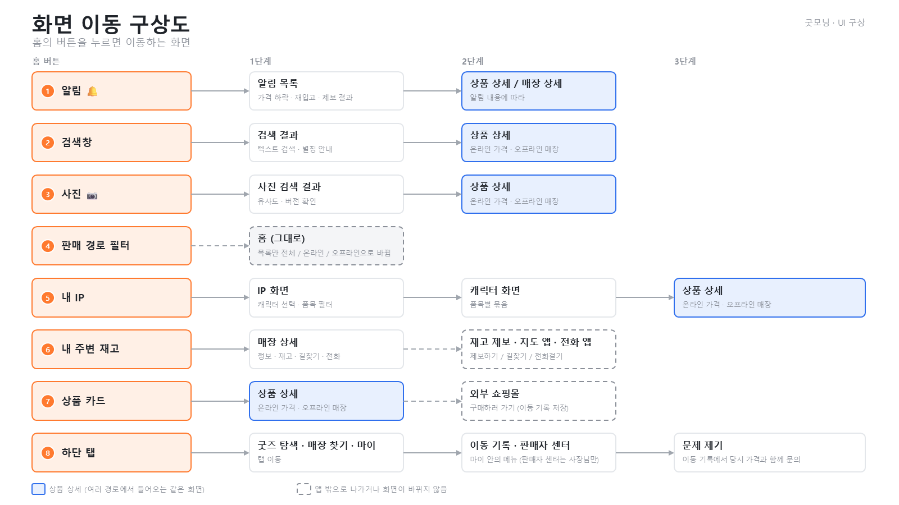
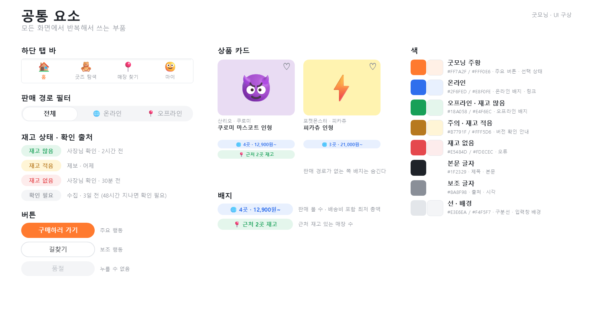

# 화면 흐름 · 공통 요소

> 슬라이드 1–3 · [목차](README.md)

## 1. 화면 이동 구상도 (홈 버튼 기준)



|홈 버튼|1단계|2단계|3단계|
|--|--|--|--|
|① 알림 🔔|알림 목록|상품 상세 / 매장 상세 (알림 내용에 따라)||
|② 검색창|검색 결과|상품 상세||
|③ 사진 📷|사진 검색 결과|상품 상세||
|④ 판매 경로 필터|홈 그대로 (목록만 바뀜)|||
|⑤ 내 IP|IP 화면|캐릭터 화면|상품 상세|
|⑥ 내 주변 재고|매장 상세|재고 제보 · 지도 앱 · 전화 앱||
|⑦ 상품 카드|상품 상세|외부 쇼핑몰 (구매하러 가기, 이동 기록 저장)||
|⑧ 하단 탭|굿즈 탐색 · 매장 찾기 · 마이|이동 기록 · 판매자 센터|문제 제기|

## 2. 화면 흐름 그래프


화면은 상자, 버튼은 화살표다. 괄호 안 숫자는 슬라이드 번호.

```mermaid
flowchart LR
    login["로그인 (4)"] -->|회원가입| su1["회원가입 · 계정 (5)"]
    su1 -->|다음| su2["회원가입 · IP 고르기 (6)"]
    su2 -->|시작하기| home(["홈 (7)"])
    login -->|로그인 · SNS| home

    home -->|🔔| noti["알림 목록 (9)"]
    home -->|검색창| search["검색 결과 (10)"]
    home -->|📷| photo["사진 검색 결과 (11)"]
    home -->|탭 · 내 IP| explore["굿즈 탐색 (8)"]
    home -->|탭 · 내 주변 재고| slist["매장 찾기 · 리스트 (17)"]
    home -->|탭| my["마이 (21)"]

    noti -->|굿즈 알림| pon["상품 상세 · 온라인 (15)"]
    search -->|결과 행| pon
    photo -->|결과 행| pon
    pon <-->|탭| poff["상품 상세 · 오프라인 (16)"]
    pon -.->|구매하러 가기 · 기록 저장| mall[["외부 쇼핑몰"]]

    explore -->|IP 타일| ipscr["IP 화면 (13)"]
    explore -->|IP 목록 조정| ipadj["IP 목록 조정 (12)"]
    ipscr -->|캐릭터| char["캐릭터 화면 (14)"]
    char -->|굿즈| pon

    poff -->|매장 선택| sdet["매장 상세 (19)"]
    slist -->|매장 카드| sdet
    slist -->|지도| smap["매장 찾기 · 지도 (18)"]
    smap -->|마커| sdet
    sdet -->|제보하기| report["재고 제보 (20)"]
    sdet -.->|길찾기 · 전화| apps[["지도 앱 · 전화 앱"]]

    my -->|이동 기록| click["이동 기록 (22)"]
    click -->|문제 제기| issue["문제 제기 (23)"]
    my -->|내 IP 바꾸기| ipadj
    my -->|판매자 센터| seller["판매자 · 재고 관리 (24)"]
    seller -->|탭| sreg["판매자 · 상품 등록 (25)"]

    classDef tab fill:#FFF0E6,stroke:#FF7A2F
    classDef hub fill:#E8F0FE,stroke:#2F6FED
    classDef sell fill:#E4F6EC,stroke:#18A058
    classDef start fill:#F4F5F7,stroke:#E3E6EA
    class explore,slist,my tab
    class pon,poff hub
    class seller,sreg sell
    class login,su1,su2 start
    style home fill:#FF7A2F,color:#fff,stroke:#FF7A2F
```

화면 이동 없이 동작하는 버튼

|버튼|동작|
|--|--|
|판매 경로 필터 · 정렬|목록만 다시 불러옴|
|♡ 찜|찜 목록에 저장|
|🔔 알림 받기|알림 조건 저장|
|⭐ 매장 저장|저장한 매장에 추가|
|오늘 재고 그대로예요|전 품목 확인 시각 갱신|
|리스트 ↔ 지도|같은 결과, 표시만 바뀜|
|홈 내 IP [+ 추가]|IP 목록 조정 화면으로|

## 3. 공통 요소



- 하단 탭 바: 🏠 홈 / 🧸 굿즈 탐색 / 📍 매장 찾기 / 🙂 마이
- 판매 경로 필터: 전체 / 🌐 온라인 / 📍 오프라인
- 재고 상태와 확인 출처

  |상태|예시 출처 · 시각|
  |--|--|
  |재고 많음|사장님 확인 · 2시간 전|
  |재고 적음|제보 · 어제|
  |재고 없음|사장님 확인 · 30분 전|
  |확인 필요|수집 · 3일 전 (확인한 지 48시간이 지나면 확인 필요)|

- 상품 카드: 사진, IP · 캐릭터, 상품명, 배지, ♡. 판매 경로가 없는 쪽 배지는 숨긴다.
- 배지: `🌐 4곳 · 12,900원~` (판매 몰 수 · 배송비 포함 최저 총액), `📍 근처 2곳 재고` (근처 재고 있는 매장 수)
- 버튼: 주요 행동 (주황 채움, 예: 구매하러 가기) / 보조 행동 (흰 바탕 테두리, 예: 길찾기) / 누를 수 없음 (회색, 예: 품절)

|이름|색|연한 색|쓰는 곳|
|--|--|--|--|
|굿모닝 주황|`#FF7A2F`|`#FFF0E6`|주요 버튼 · 선택 상태|
|온라인|`#2F6FED`|`#E8F0FE`|온라인 배지 · 링크|
|오프라인 · 재고 많음|`#18A058`|`#E4F6EC`|오프라인 배지|
|주의 · 재고 적음|`#B7791F`|`#FFF5D6`|버전 확인 안내|
|재고 없음|`#E5484D`|`#FDECEC`|오류|
|본문 글자|`#1F2329`||제목 · 본문|
|보조 글자|`#8A8F98`||출처 · 시각|
|선 · 배경|`#E3E6EA`|`#F4F5F7`|구분선 · 입력창 배경|
