# 화면별 UI

> 슬라이드 4–25 · [목차](README.md)

## 4. 로그인 — 앱을 처음 열거나 로그아웃 상태일 때

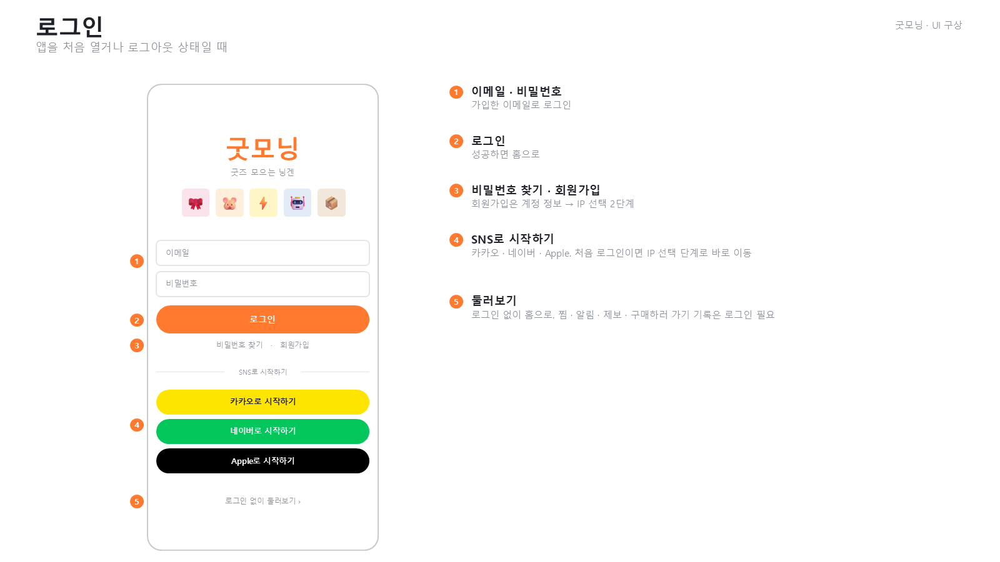

1. 이메일 · 비밀번호: 가입한 이메일로 로그인
2. 로그인: 성공하면 홈으로
3. 비밀번호 찾기 · 회원가입: 회원가입은 계정 정보 → IP 선택 2단계
4. SNS로 시작하기: 카카오 · 네이버 · Apple. 처음 로그인이면 IP 선택 단계로 바로 이동
5. 둘러보기: 로그인 없이 홈으로. 찜 · 알림 · 제보 · 구매하러 가기 기록은 로그인 필요

## 5. 회원가입 · 계정 정보 — 1단계

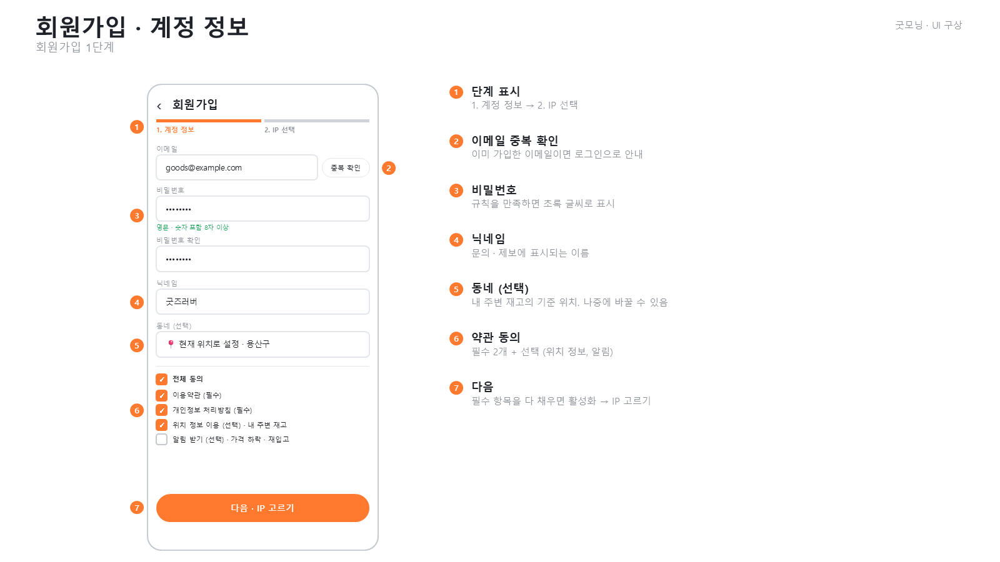

1. 단계 표시: 1. 계정 정보 → 2. IP 선택
2. 이메일 중복 확인: 이미 가입한 이메일이면 로그인으로 안내
3. 비밀번호: 규칙(영문 · 숫자 포함 8자 이상)을 만족하면 초록 글씨로 표시
4. 닉네임: 문의 · 제보에 표시되는 이름
5. 동네 (선택): 내 주변 재고의 기준 위치. 나중에 바꿀 수 있음
6. 약관 동의: 필수 2개(이용약관, 개인정보 처리방침) + 선택(위치 정보, 알림)
7. 다음: 필수 항목을 다 채우면 활성화 → IP 고르기

## 6. 회원가입 · IP 고르기 — 2단계, 고른 IP만 홈과 굿즈 탐색에 보인다

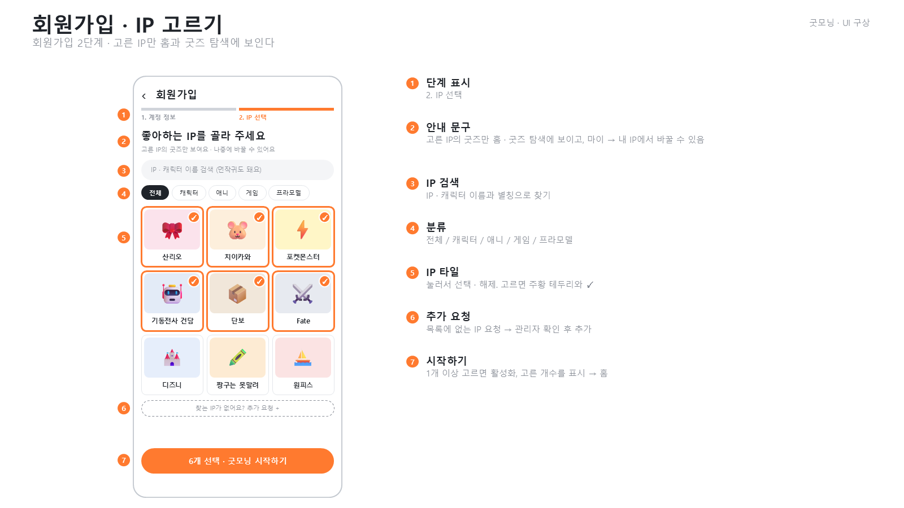

1. 단계 표시: 2. IP 선택
2. 안내 문구: 고른 IP의 굿즈만 홈 · 굿즈 탐색에 보이고, 마이 → 내 IP에서 바꿀 수 있음
3. IP 검색: IP · 캐릭터 이름과 별칭으로 찾기
4. 분류: 전체 / 캐릭터 / 애니 / 게임 / 프라모델
5. IP 타일: 눌러서 선택 · 해제. 고르면 주황 테두리와 ✓
6. 추가 요청: 목록에 없는 IP 요청 → 관리자 확인 후 추가
7. 시작하기: 1개 이상 고르면 활성화, 고른 개수를 표시 → 홈

## 7. 홈 — 앱을 열면 처음 보이는 화면

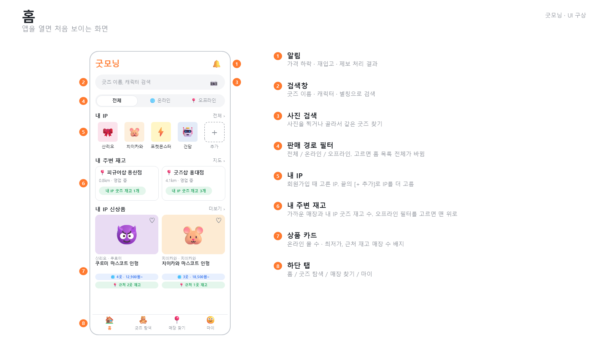

1. 알림 🔔: 가격 하락 · 재입고 · 제보 처리 결과
2. 검색창: 굿즈 이름 · 캐릭터 · 별칭으로 검색
3. 사진 검색 📷: 사진을 찍거나 골라서 같은 굿즈 찾기
4. 판매 경로 필터: 전체 / 온라인 / 오프라인. 고르면 홈 목록 전체가 바뀜
5. 내 IP: 회원가입 때 고른 IP. 끝의 [+ 추가]로 IP를 더 고름
6. 내 주변 재고: 가까운 매장과 내 IP 굿즈 재고 수. 오프라인 필터를 고르면 맨 위로
7. 상품 카드: 온라인 몰 수 · 최저가, 근처 재고 매장 수 배지
8. 하단 탭: 홈 / 굿즈 탐색 / 매장 찾기 / 마이

## 8. 굿즈 탐색 — 품목이나 IP로 굿즈를 찾아 들어가는 화면

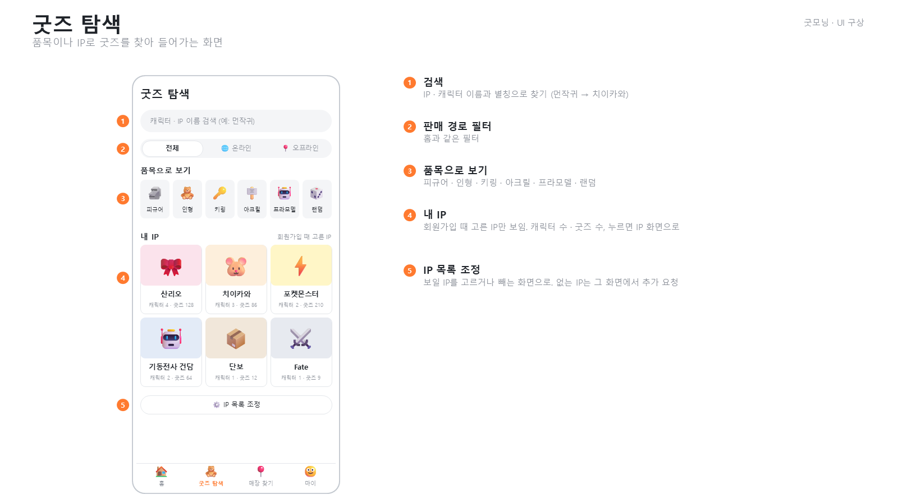

1. 검색: IP · 캐릭터 이름과 별칭으로 찾기 (먼작귀 → 치이카와)
2. 판매 경로 필터: 홈과 같은 필터
3. 품목으로 보기: 피규어 · 인형 · 키링 · 아크릴 · 프라모델 · 랜덤
4. 내 IP: 회원가입 때 고른 IP만 보임. 캐릭터 수 · 굿즈 수, 누르면 IP 화면으로
5. IP 목록 조정: 보일 IP를 고르거나 빼는 화면으로. 없는 IP는 그 화면에서 추가 요청

## 9. 알림 목록 — 홈의 🔔

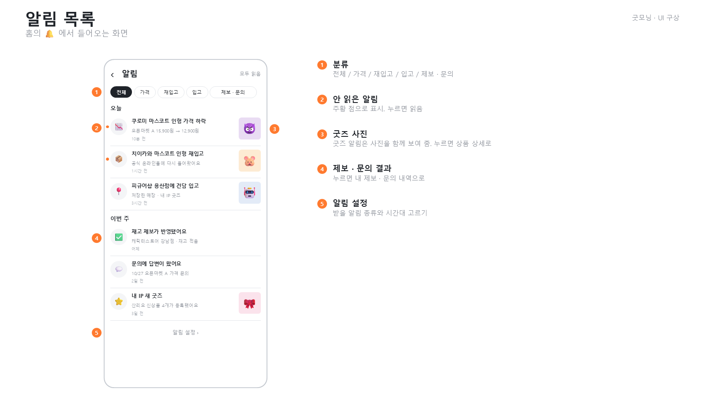

1. 분류: 전체 / 가격 / 재입고 / 입고 / 제보 · 문의
2. 안 읽은 알림: 주황 점으로 표시. 누르면 읽음
3. 굿즈 사진: 굿즈 알림은 사진을 함께 보여 줌. 누르면 상품 상세로
4. 제보 · 문의 결과: 누르면 내 제보 · 문의 내역으로
5. 알림 설정: 받을 알림 종류와 시간대 고르기

## 10. 검색 결과 — 검색창에 입력한 뒤

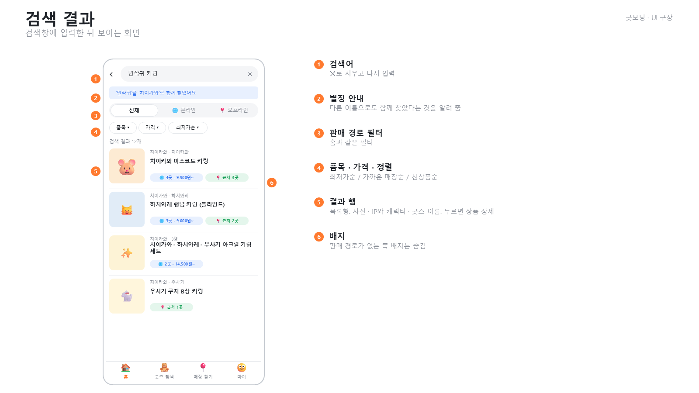

1. 검색어: ✕로 지우고 다시 입력
2. 별칭 안내: 다른 이름으로도 함께 찾았다는 것을 알려 줌 ("먼작귀"를 "치이카와"로 함께 찾았어요)
3. 판매 경로 필터: 홈과 같은 필터
4. 품목 · 가격 · 정렬: 최저가순 / 가까운 매장순 / 신상품순
5. 결과 행: 목록형. 사진 · IP와 캐릭터 · 굿즈 이름. 누르면 상품 상세
6. 배지: 판매 경로가 없는 쪽 배지는 숨김

## 11. 사진 검색 결과 — 홈의 📷 으로 사진을 올린 뒤

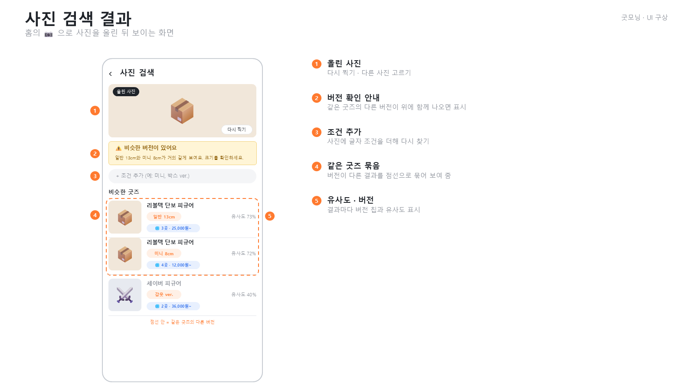

1. 올린 사진: 다시 찍기 · 다른 사진 고르기
2. 버전 확인 안내: 같은 굿즈의 다른 버전이 위에 함께 나오면 표시 (일반 13cm와 미니 8cm가 거의 같게 보여요)
3. 조건 추가: 사진에 글자 조건을 더해 다시 찾기 (예: 미니, 박스 ver.)
4. 같은 굿즈 묶음: 버전이 다른 결과를 점선으로 묶어 보여 줌
5. 유사도 · 버전: 결과마다 버전 칩과 유사도 표시

## 12. IP 목록 조정 — 홈의 [+ 추가], 굿즈 탐색의 [IP 목록 조정], 마이의 내 IP

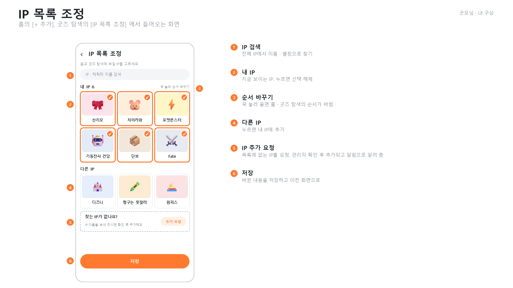

1. IP 검색: 전체 IP에서 이름 · 별칭으로 찾기
2. 내 IP: 지금 보이는 IP. 누르면 선택 해제
3. 순서 바꾸기: 꾹 눌러 끌면 홈 · 굿즈 탐색의 순서가 바뀜
4. 다른 IP: 누르면 내 IP에 추가
5. IP 추가 요청: 목록에 없는 IP를 요청. 관리자 확인 후 추가되고 알림으로 알려 줌
6. 저장: 바뀐 내용을 저장하고 이전 화면으로

## 13. IP 화면 — 굿즈 탐색에서 IP를 고르면 (예: 산리오)

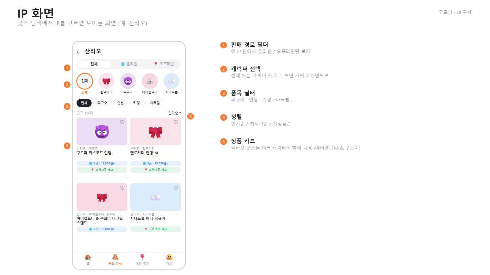

1. 판매 경로 필터: 이 IP 안에서 온라인 / 오프라인만 보기
2. 캐릭터 선택: 전체 또는 캐릭터 하나. 누르면 캐릭터 화면으로
3. 품목 필터: 피규어 · 인형 · 키링 · 아크릴 …
4. 정렬: 인기순 / 최저가순 / 신상품순
5. 상품 카드: 콜라보 굿즈는 여러 캐릭터에 함께 나옴 (마이멜로디 & 쿠로미)

## 14. 캐릭터 화면 — IP 화면에서 캐릭터를 고르면 (예: 쿠로미)

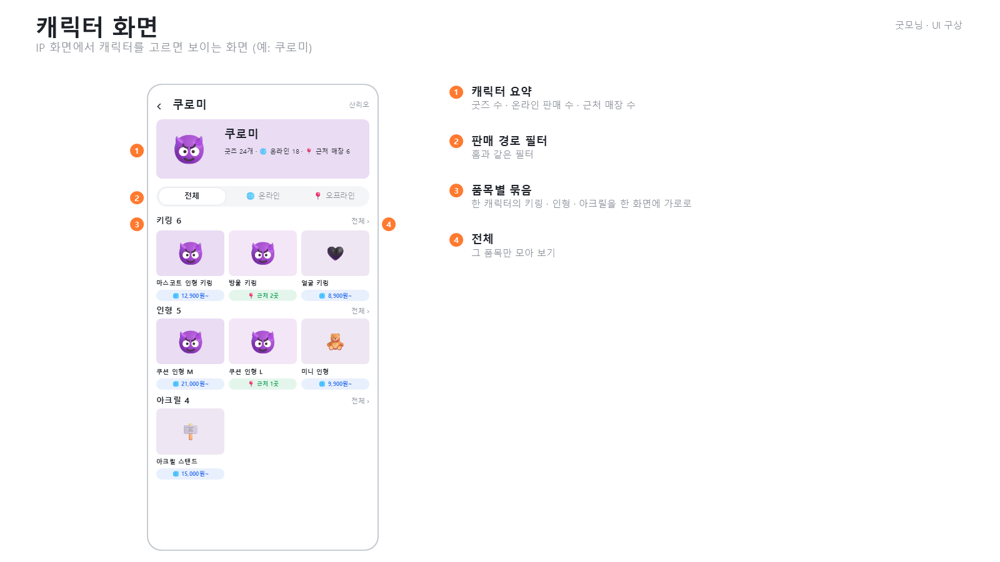

1. 캐릭터 요약: 굿즈 수 · 온라인 판매 수 · 근처 매장 수
2. 판매 경로 필터: 홈과 같은 필터
3. 품목별 묶음: 한 캐릭터의 키링 · 인형 · 아크릴을 한 화면에 가로로
4. 전체: 그 품목만 모아 보기

## 15. 상품 상세 · 온라인 가격 — 어느 화면에서든 상품을 누르면

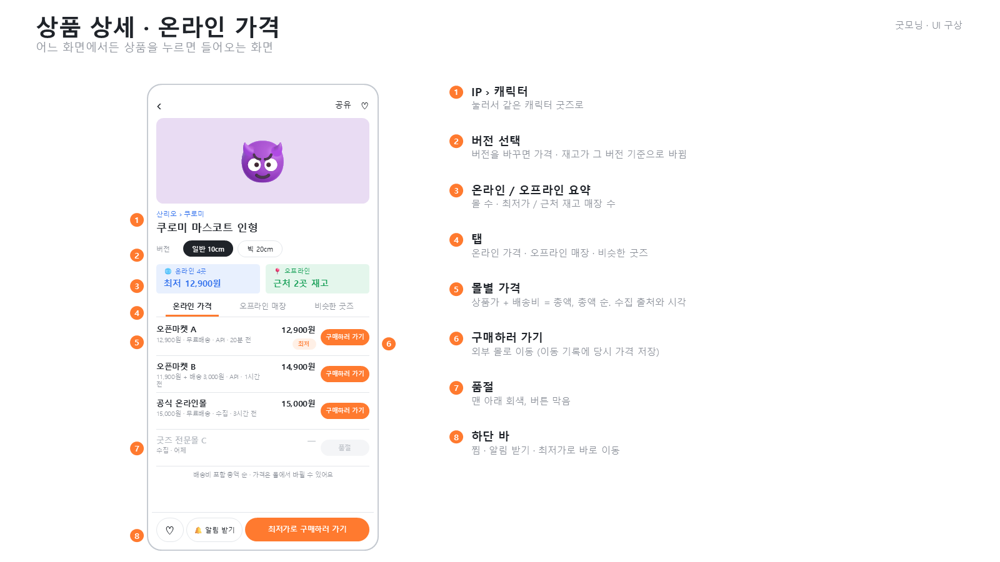

1. IP › 캐릭터: 눌러서 같은 캐릭터 굿즈로
2. 버전 선택: 버전을 바꾸면 가격 · 재고가 그 버전 기준으로 바뀜
3. 온라인 / 오프라인 요약: 몰 수 · 최저가 / 근처 재고 매장 수
4. 탭: 온라인 가격 · 오프라인 매장 · 비슷한 굿즈
5. 몰별 가격: 상품가 + 배송비 = 총액, 총액 순. 수집 출처와 시각
6. 구매하러 가기: 외부 몰로 이동 (이동 기록에 당시 가격 저장)
7. 품절: 맨 아래 회색, 버튼 막음
8. 하단 바: 찜 · 알림 받기 · 최저가로 바로 이동

## 16. 상품 상세 · 오프라인 매장 — 상품 상세의 [오프라인 매장] 탭

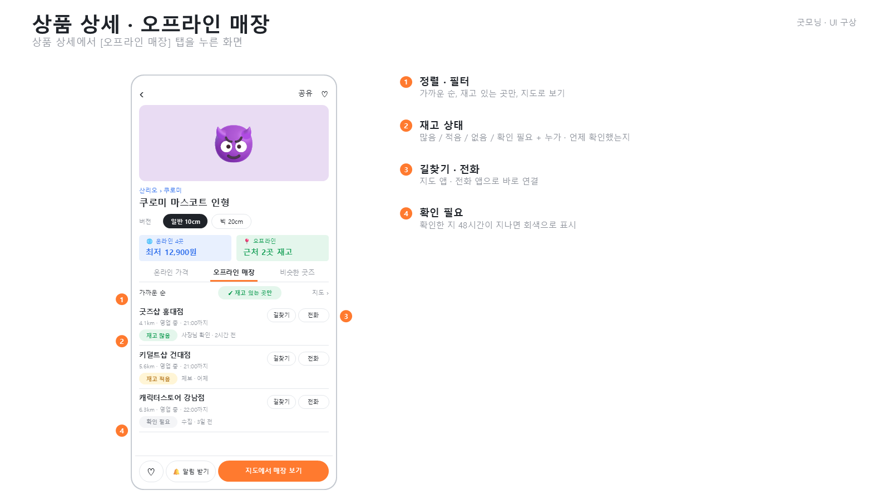

1. 정렬 · 필터: 가까운 순, 재고 있는 곳만, 지도로 보기
2. 재고 상태: 많음 / 적음 / 없음 / 확인 필요 + 누가 · 언제 확인했는지
3. 길찾기 · 전화: 지도 앱 · 전화 앱으로 바로 연결
4. 확인 필요: 확인한 지 48시간이 지나면 회색으로 표시

## 17. 매장 찾기 · 리스트 — 하단 탭 [매장 찾기]

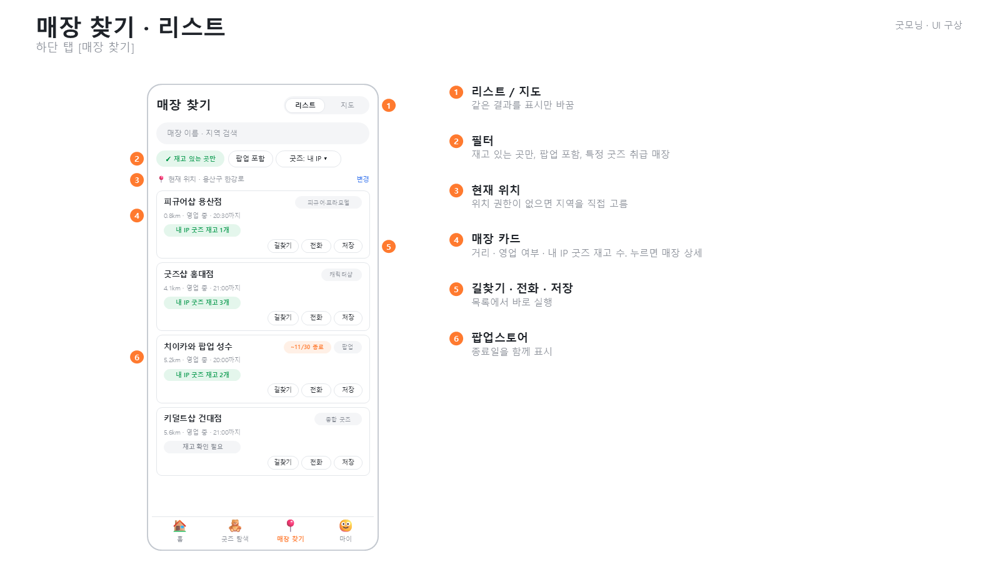

1. 리스트 / 지도: 같은 결과를 표시만 바꿈
2. 필터: 재고 있는 곳만, 팝업 포함, 특정 굿즈 취급 매장
3. 현재 위치: 위치 권한이 없으면 지역을 직접 고름
4. 매장 카드: 거리 · 영업 여부 · 내 IP 굿즈 재고 수. 누르면 매장 상세
5. 길찾기 · 전화 · 저장: 목록에서 바로 실행
6. 팝업스토어: 종료일을 함께 표시

## 18. 매장 찾기 · 지도 — 매장 찾기에서 [지도]

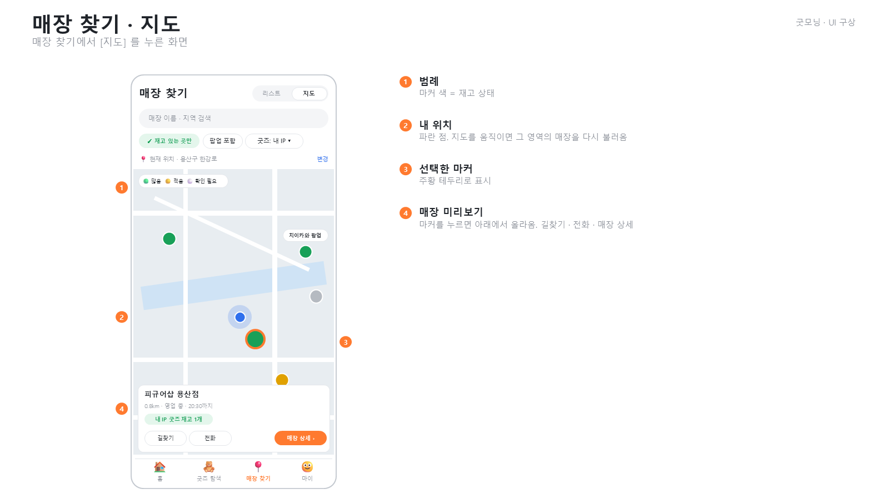

1. 범례: 마커 색 = 재고 상태
2. 내 위치: 파란 점. 지도를 움직이면 그 영역의 매장을 다시 불러옴
3. 선택한 마커: 주황 테두리로 표시
4. 매장 미리보기: 마커를 누르면 아래에서 올라옴. 길찾기 · 전화 · 매장 상세

## 19. 매장 상세 — 매장 카드 · 지도 마커 · 상품 상세의 매장

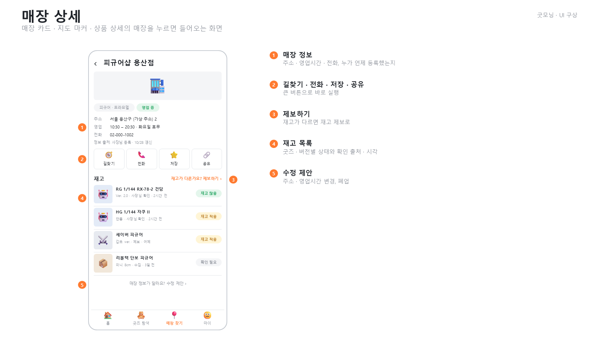

1. 매장 정보: 주소 · 영업시간 · 전화, 누가 언제 등록했는지
2. 길찾기 · 전화 · 저장 · 공유: 큰 버튼으로 바로 실행
3. 제보하기: 재고가 다르면 재고 제보로
4. 재고 목록: 굿즈 · 버전별 상태와 확인 출처 · 시각
5. 수정 제안: 주소 · 영업시간 변경, 폐업

## 20. 재고 제보 — 매장 상세의 [제보하기] 를 누르면 아래에서 올라오는 창

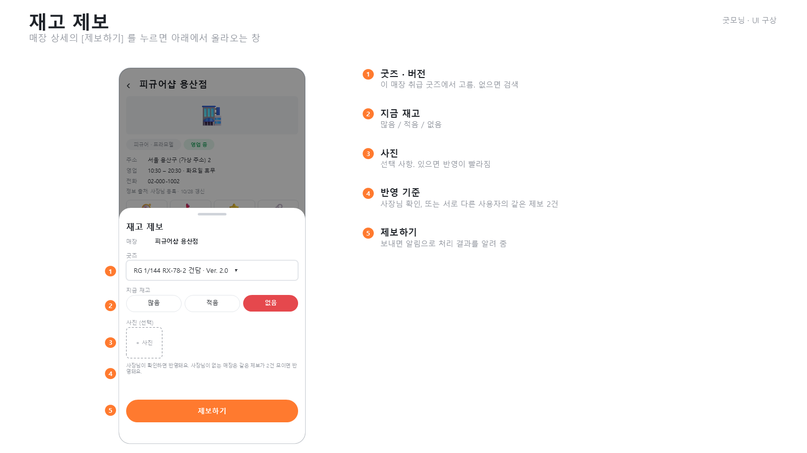

1. 굿즈 · 버전: 이 매장 취급 굿즈에서 고름. 없으면 검색
2. 지금 재고: 많음 / 적음 / 없음
3. 사진: 선택 사항. 있으면 반영이 빨라짐
4. 반영 기준: 사장님 확인, 또는 서로 다른 사용자의 같은 제보 2건
5. 제보하기: 보내면 알림으로 처리 결과를 알려 줌

## 21. 마이 — 하단 탭 [마이]

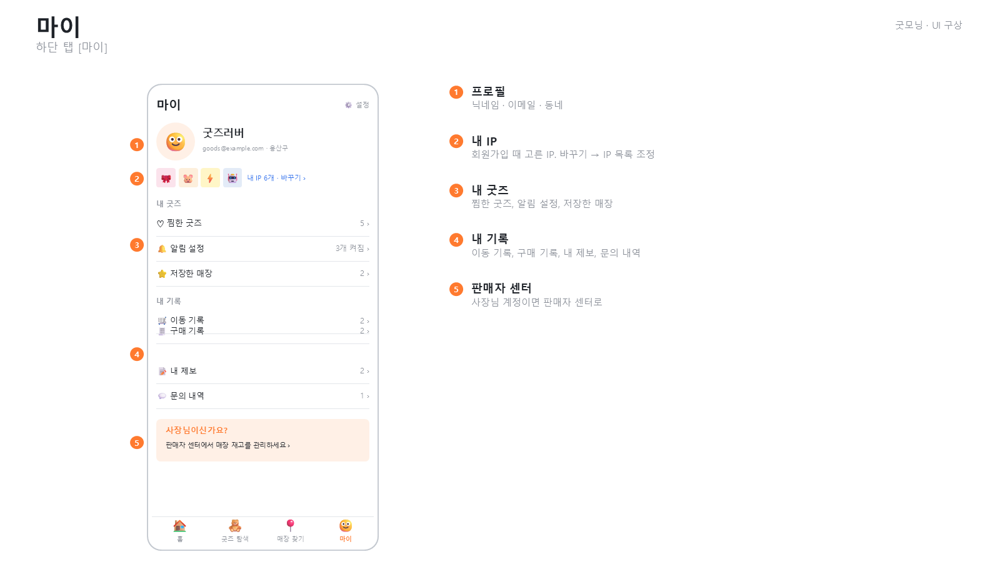

1. 프로필: 닉네임 · 이메일 · 동네
2. 내 IP: 회원가입 때 고른 IP. 바꾸기 → IP 목록 조정
3. 내 굿즈: 찜한 굿즈, 알림 설정, 저장한 매장
4. 내 기록: 이동 기록, 구매 기록, 내 제보, 문의 내역
5. 판매자 센터: 사장님 계정이면 판매자 센터로

## 22. 이동 기록 — 마이 → 이동 기록

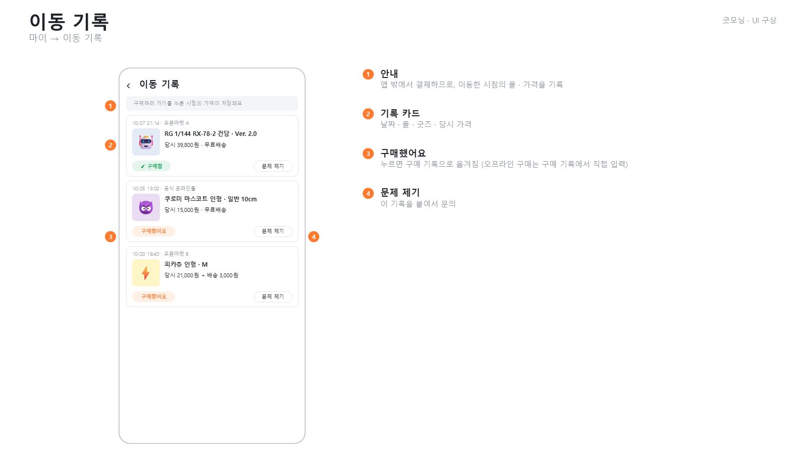

1. 안내: 앱 밖에서 결제하므로, 이동한 시점의 몰 · 가격을 기록
2. 기록 카드: 날짜 · 몰 · 굿즈 · 당시 가격
3. 구매했어요: 누르면 구매 기록으로 옮겨짐 (오프라인 구매는 구매 기록에서 직접 입력)
4. 문제 제기: 이 기록을 붙여서 문의

## 23. 문제 제기 — 이동 기록 · 구매 기록에서 [문제 제기] 를 누르면 올라오는 창

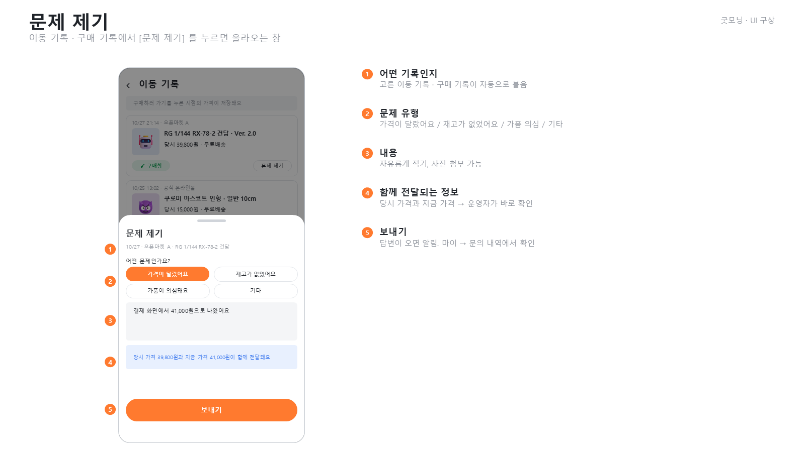

1. 어떤 기록인지: 고른 이동 기록 · 구매 기록이 자동으로 붙음
2. 문제 유형: 가격이 달랐어요 / 재고가 없었어요 / 가품 의심 / 기타
3. 내용: 자유롭게 적기, 사진 첨부 가능
4. 함께 전달되는 정보: 당시 가격과 지금 가격 → 운영자가 바로 확인
5. 보내기: 답변이 오면 알림. 마이 → 문의 내역에서 확인

## 24. 판매자 센터 · 재고 관리 — 사장님 계정 · 마이 → 판매자 센터

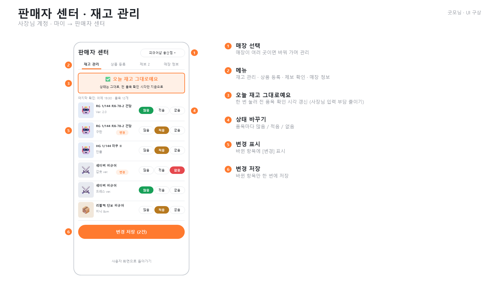

1. 매장 선택: 매장이 여러 곳이면 바꿔 가며 관리
2. 메뉴: 재고 관리 · 상품 등록 · 제보 확인 · 매장 정보
3. 오늘 재고 그대로예요: 한 번 눌러 전 품목 확인 시각 갱신 (사장님 입력 부담 줄이기)
4. 상태 바꾸기: 품목마다 많음 / 적음 / 없음
5. 변경 표시: 바뀐 항목에 [변경] 표시
6. 변경 저장: 바뀐 항목만 한 번에 저장

## 25. 판매자 센터 · 상품 등록 — 판매자 센터 → [상품 등록]

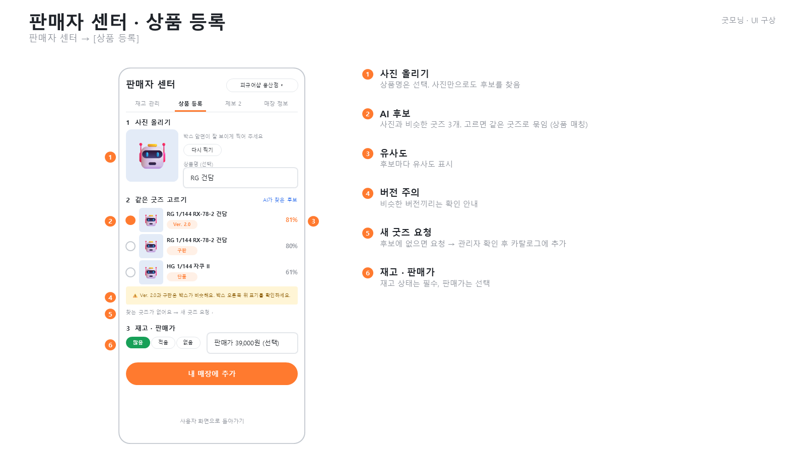

1. 사진 올리기: 상품명은 선택. 사진만으로도 후보를 찾음
2. AI 후보: 사진과 비슷한 굿즈 3개. 고르면 같은 굿즈로 묶임 (상품 매칭)
3. 유사도: 후보마다 유사도 표시
4. 버전 주의: 비슷한 버전끼리는 확인 안내
5. 새 굿즈 요청: 후보에 없으면 요청 → 관리자 확인 후 카탈로그에 추가
6. 재고 · 판매가: 재고 상태는 필수, 판매가는 선택
