# 기술 스펙

> 슬라이드 26–36 · [목차](README.md)


## 26. 기술 스택

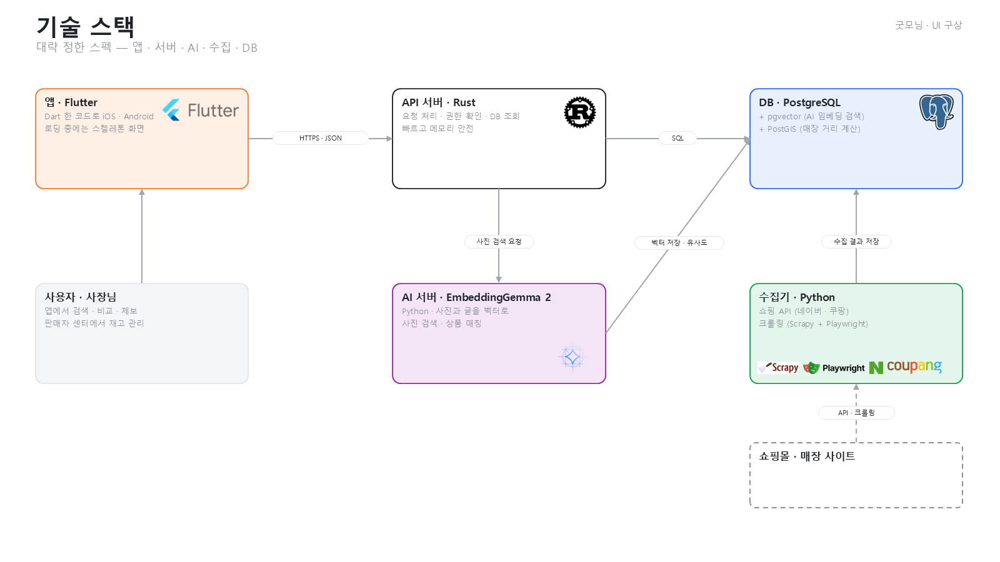

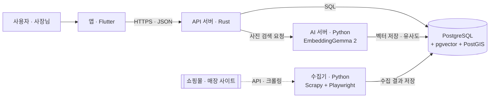

## 27. 데이터 수집 ① 크롤링 — API가 없는 몰 · 매장 공지

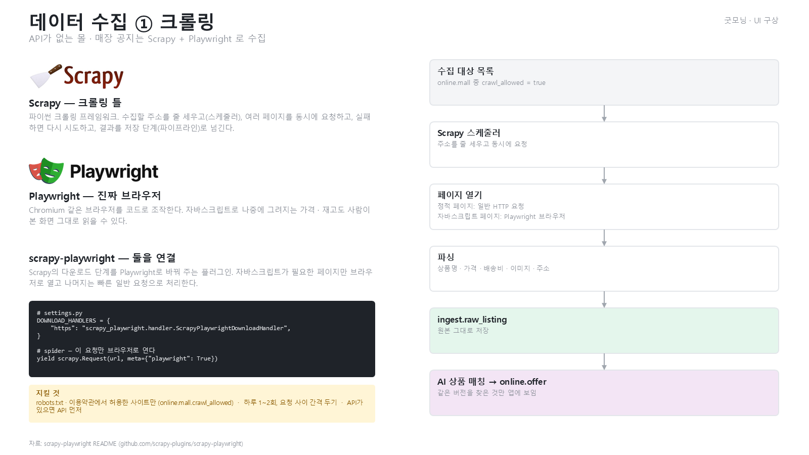

- Scrapy: 파이썬 크롤링 틀. 수집할 주소를 줄 세우고(스케줄러), 여러 페이지를 동시에 요청하고, 실패하면 다시 시도하고, 결과를 저장 단계(파이프라인)로 넘긴다.
- Playwright: Chromium 같은 브라우저를 코드로 조작한다. 자바스크립트로 나중에 그려지는 가격 · 재고도 사람이 본 화면 그대로 읽는다.
- scrapy-playwright: Scrapy의 다운로드 단계를 Playwright로 바꿔 주는 플러그인. 자바스크립트가 필요한 페이지만 브라우저로 열고 나머지는 일반 요청으로 처리한다.

```python
# settings.py
DOWNLOAD_HANDLERS = {
    "https": "scrapy_playwright.handler.ScrapyPlaywrightDownloadHandler",
}

# spider — 이 요청만 브라우저로 연다
yield scrapy.Request(url, meta={"playwright": True})
```

수집 흐름: 수집 대상 목록 (`online.mall` 중 `crawl_allowed = true`) → Scrapy 스케줄러 → 페이지 열기 (정적 페이지는 일반 요청, 자바스크립트 페이지는 Playwright) → 파싱 (상품명 · 가격 · 배송비 · 이미지 · 주소) → `ingest.raw_listing` → AI 상품 매칭 → `online.offer`

지킬 것: robots.txt · 이용약관에서 허용한 사이트만, 하루 1~2회 · 요청 사이 간격 두기, API가 있으면 API 먼저.

자료: scrapy-playwright README (github.com/scrapy-plugins/scrapy-playwright)

## 28. 데이터 수집 ② 쇼핑 API — 크롤링보다 안정적이고 약관 문제가 없음

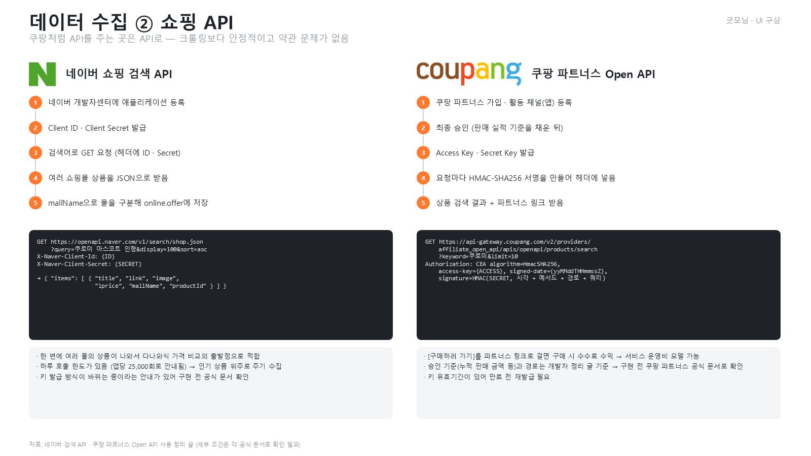

**네이버 쇼핑 검색 API**

1. 네이버 개발자센터에 애플리케이션 등록
2. Client ID · Client Secret 발급
3. 검색어로 GET 요청 (헤더에 ID · Secret)
4. 여러 쇼핑몰 상품을 JSON으로 받음
5. `mallName`으로 몰을 구분해 `online.offer`에 저장

```http
GET https://openapi.naver.com/v1/search/shop.json?query=쿠로미 마스코트 인형&display=100&sort=asc
X-Naver-Client-Id: {ID}
X-Naver-Client-Secret: {SECRET}
```

- 한 번에 여러 몰의 상품이 나와 가격 비교의 출발점으로 적합
- 하루 호출 한도가 있음 (앱당 25,000회로 안내됨) → 인기 상품 위주로 주기 수집
- 키 발급 방식이 바뀌는 중이라는 안내가 있어 구현 전 공식 문서 확인

**쿠팡 파트너스 Open API**

1. 쿠팡 파트너스 가입 · 활동 채널(앱) 등록
2. 최종 승인 (판매 실적 기준을 채운 뒤)
3. Access Key · Secret Key 발급
4. 요청마다 HMAC-SHA256 서명을 만들어 헤더에 넣음
5. 상품 검색 결과 + 파트너스 링크 받음

```http
GET https://api-gateway.coupang.com/v2/providers/affiliate_open_api/apis/openapi/products/search?keyword=쿠로미&limit=10
Authorization: CEA algorithm=HmacSHA256, access-key={ACCESS}, signed-date={yyMMddTHHmmssZ}, signature={HMAC(SECRET, 시각 + 메서드 + 경로 + 쿼리)}
```

- [구매하러 가기]를 파트너스 링크로 걸면 구매 시 수수료 수익 → 서비스 운영비 모델 가능
- 승인 기준(누적 판매 금액 등)과 경로는 개발자 정리 글 기준 → 구현 전 쿠팡 파트너스 공식 문서로 확인
- 키 유효기간이 있어 만료 전 재발급 필요

## 29. AI ① EmbeddingGemma 2 가 하는 일

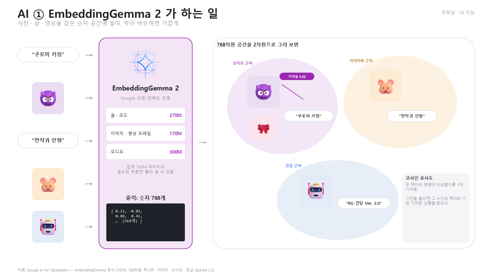

사진 · 글 · 영상을 같은 숫자 공간(768차원 벡터)에 놓아, 뜻이 비슷하면 가깝게 만든다.

- 입력: "쿠로미 키링"(글), 쿠로미 사진, "먼작귀 인형"(글), 치이카와 사진, 건담 사진
- 모델: Google 오픈 임베딩 모델, 합계 740M 파라미터 (글 · 코드 270M + 이미지 · 영상 프레임 170M + 오디오 300M, 필요한 부분만 불러 쓸 수 있음)
- 출력: 숫자 768개
- 2차원으로 그려 보면 쿠로미 사진과 "쿠로미 키링"이 가깝고, 치이카와 · 건담은 각자 다른 곳에 모인다.
- 코사인 유사도: 두 벡터의 방향이 비슷할수록 1에 가깝다. 사진을 올리면 그 사진의 벡터와 가장 가까운 상품을 찾는다.

자료: Google AI for Developers — EmbeddingGemma 문서

## 30. AI ② 굿모닝에서 쓰는 곳

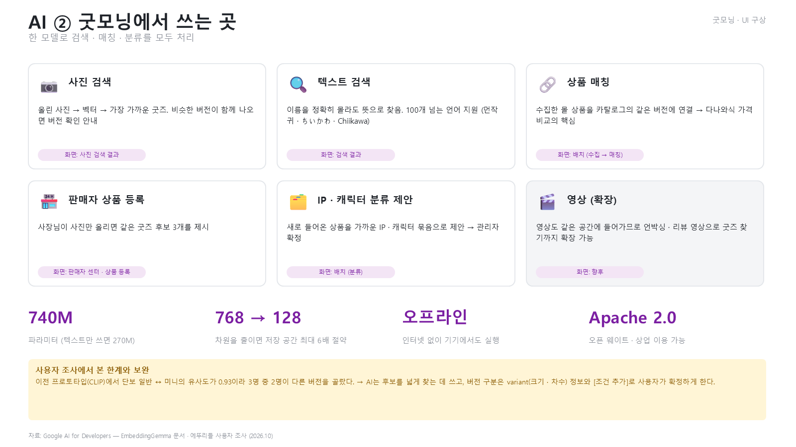

|쓰는 곳|하는 일|화면|
|--|--|--|
|📷 사진 검색|올린 사진 → 벡터 → 가장 가까운 굿즈. 비슷한 버전이 함께 나오면 버전 확인 안내|사진 검색 결과|
|🔍 텍스트 검색|이름을 정확히 몰라도 뜻으로 찾음. 100개 넘는 언어 지원 (먼작귀 · ちいかわ · Chiikawa)|검색 결과|
|🔗 상품 매칭|수집한 몰 상품을 카탈로그의 같은 버전에 연결 → 가격 비교의 핵심|배치 (수집 → 매칭)|
|🏪 판매자 상품 등록|사장님이 사진만 올리면 같은 굿즈 후보 3개를 제시|판매자 센터 · 상품 등록|
|🗂️ IP · 캐릭터 분류 제안|새 상품을 가까운 IP · 캐릭터 묶음으로 제안 → 관리자 확정|배치 (분류)|
|🎬 영상 (확장)|영상도 같은 공간에 들어가므로 언박싱 · 리뷰 영상으로 굿즈 찾기까지 확장 가능|향후|

- 740M 파라미터 (텍스트만 쓰면 270M)
- 768 → 128: 차원을 줄이면 저장 공간 최대 6배 절약
- 오프라인: 인터넷 없이 기기에서도 실행
- Apache 2.0: 오픈 웨이트 · 상업 이용 가능

사용자 조사에서 본 한계와 보완: 이전 프로토타입(CLIP)에서 단보 일반 ↔ 미니의 유사도가 0.93이라 3명 중 2명이 다른 버전을 골랐다. → AI는 후보를 넓게 찾는 데 쓰고, 버전 구분은 variant(크기 · 차수) 정보와 [조건 추가]로 사용자가 확정하게 한다.

## 31. DB · PostgreSQL — 개발자가 가장 많이 쓰는 DB

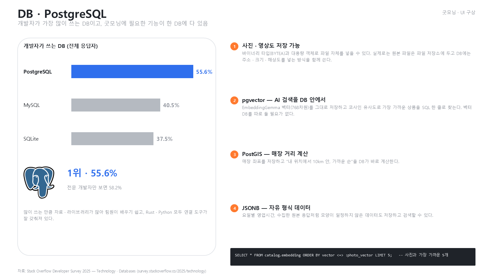

|DB|개발자 사용 비율 (전체 응답자)|
|--|--|
|PostgreSQL|55.6% (1위, 전문 개발자만 보면 58.2%)|
|MySQL|40.5%|
|SQLite|37.5%|

1. 사진 · 영상도 저장 가능: 바이너리 타입(BYTEA)과 대용량 객체로 파일 자체를 넣을 수 있다. 실제로는 원본 파일은 파일 저장소에 두고 DB에는 주소 · 크기 · 해상도를 넣는 방식을 함께 쓴다.
2. pgvector — AI 검색을 DB 안에서: EmbeddingGemma 벡터(768차원)를 저장하고 코사인 유사도로 가장 가까운 상품을 SQL 한 줄로 찾는다. 벡터 DB를 따로 둘 필요가 없다.
3. PostGIS — 매장 거리 계산: "내 위치에서 10km 안, 가까운 순"을 DB가 바로 계산한다.
4. JSONB — 자유 형식 데이터: 요일별 영업시간, 수집한 원본 응답처럼 모양이 일정하지 않은 데이터도 저장하고 검색한다.

```sql
SELECT * FROM catalog.embedding ORDER BY vector <=> :photo_vector LIMIT 5;  -- 사진과 가장 가까운 5개
```

자료: Stack Overflow Developer Survey 2025 — Technology · Databases

## 32. 앱 · Flutter — React Native 대신 Flutter

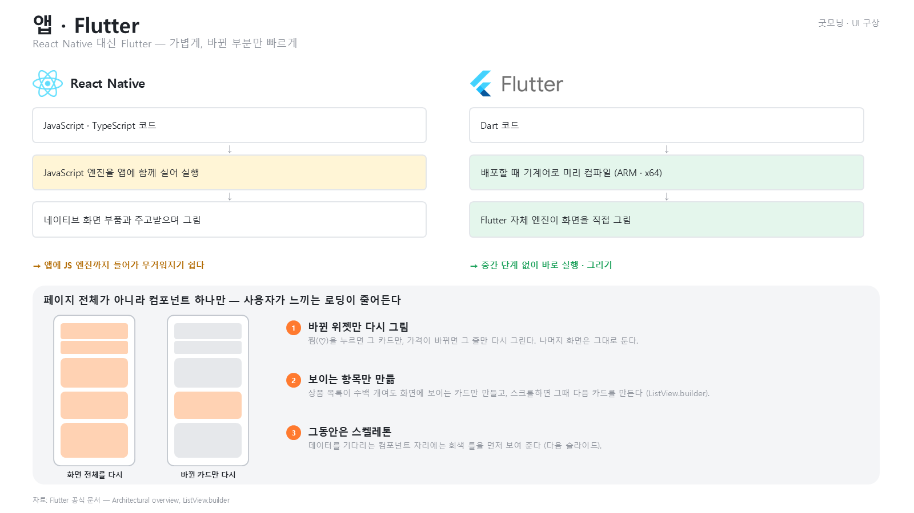

|단계|React Native|Flutter|
|--|--|--|
|코드|JavaScript · TypeScript|Dart|
|실행|JavaScript 엔진을 앱에 함께 실어 실행|배포할 때 기계어로 미리 컴파일 (ARM · x64)|
|화면 그리기|네이티브 화면 부품과 주고받으며 그림|Flutter 자체 엔진이 화면을 직접 그림|
|결과|앱에 JS 엔진까지 들어가 무거워지기 쉬움|중간 단계 없이 바로 실행 · 그리기|

페이지 전체가 아니라 컴포넌트 하나만 — 사용자가 느끼는 로딩이 줄어든다.

1. 바뀐 위젯만 다시 그림: 찜(♡)을 누르면 그 카드만, 가격이 바뀌면 그 줄만 다시 그린다.
2. 보이는 항목만 만듦: 상품 목록이 수백 개여도 화면에 보이는 카드만 만들고, 스크롤하면 다음 카드를 만든다 (`ListView.builder`).
3. 그동안은 스켈레톤: 데이터를 기다리는 자리에는 회색 틀을 먼저 보여 준다.

자료: Flutter 공식 문서 — Architectural overview, ListView.builder

## 33. 앱 · 미리 로딩과 부분 로딩 — 홈에 들어온 순간부터 다음 화면을 준비

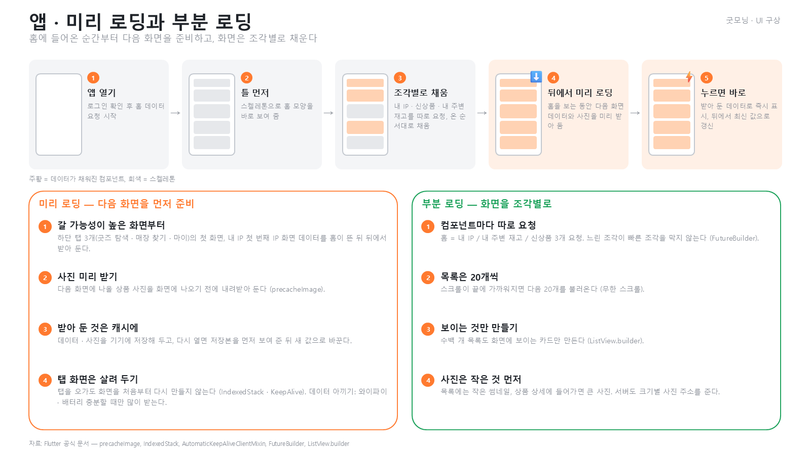

흐름: ① 앱 열기 (로그인 확인 후 홈 데이터 요청) → ② 틀 먼저 (스켈레톤) → ③ 조각별로 채움 (내 IP · 신상품 · 내 주변 재고를 따로 요청, 온 순서대로) → ④ 뒤에서 미리 로딩 (홈을 보는 동안 다음 화면 데이터와 사진을 받아 둠) → ⑤ 누르면 바로 (받아 둔 데이터로 즉시 표시, 뒤에서 최신 값으로 갱신)

**미리 로딩 — 다음 화면을 먼저 준비**

1. 갈 가능성이 높은 화면부터: 하단 탭 3개(굿즈 탐색 · 매장 찾기 · 마이)의 첫 화면, 내 IP 첫 번째 IP 화면 데이터를 홈이 뜬 뒤 뒤에서 받아 둔다.
2. 사진 미리 받기: 다음 화면에 나올 상품 사진을 화면에 나오기 전에 내려받아 둔다 (`precacheImage`).
3. 받아 둔 것은 캐시에: 데이터 · 사진을 기기에 저장해 두고, 다시 열면 저장본을 먼저 보여 준 뒤 새 값으로 바꾼다.
4. 탭 화면은 살려 두기: 탭을 오가도 화면을 처음부터 다시 만들지 않는다 (`IndexedStack` · `AutomaticKeepAliveClientMixin`). 와이파이 · 배터리가 충분할 때만 많이 받는다.

**부분 로딩 — 화면을 조각별로**

1. 컴포넌트마다 따로 요청: 홈 = 내 IP / 내 주변 재고 / 신상품 3개 요청. 느린 조각이 빠른 조각을 막지 않는다 (`FutureBuilder`).
2. 목록은 20개씩: 스크롤이 끝에 가까워지면 다음 20개를 불러온다 (무한 스크롤).
3. 보이는 것만 만들기: 수백 개 목록도 화면에 보이는 카드만 만든다 (`ListView.builder`).
4. 사진은 작은 것 먼저: 목록에는 작은 썸네일, 상품 상세에 들어가면 큰 사진. 서버도 크기별 사진 주소를 준다.

## 34. 앱 · 스켈레톤 로딩 — 멈춘 화면이 아니라 "불러오는 중"으로 느끼게

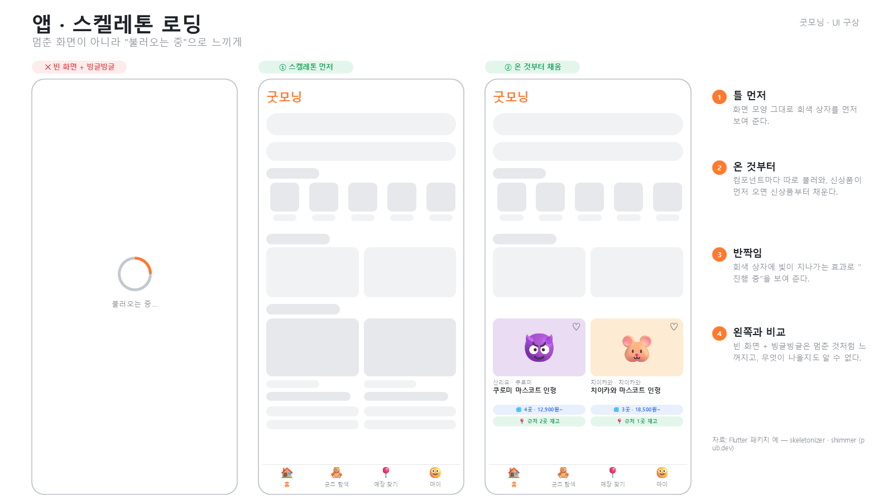

화면 비교: 빈 화면 + 빙글빙글 (✕) / ① 스켈레톤 먼저 / ② 온 것부터 채움

1. 틀 먼저: 화면 모양 그대로 회색 상자를 먼저 보여 준다.
2. 온 것부터: 컴포넌트마다 따로 불러와, 신상품이 먼저 오면 신상품부터 채운다.
3. 반짝임: 회색 상자에 빛이 지나가는 효과로 "진행 중"을 보여 준다.
4. 왼쪽과 비교: 빈 화면 + 빙글빙글은 멈춘 것처럼 느껴지고, 무엇이 나올지도 알 수 없다.

자료: Flutter 패키지 예 — skeletonizer · shimmer (pub.dev)

## 35. 서버 · Rust ① — Node.js 서버에서 Rust로 옮겨 가는 흐름

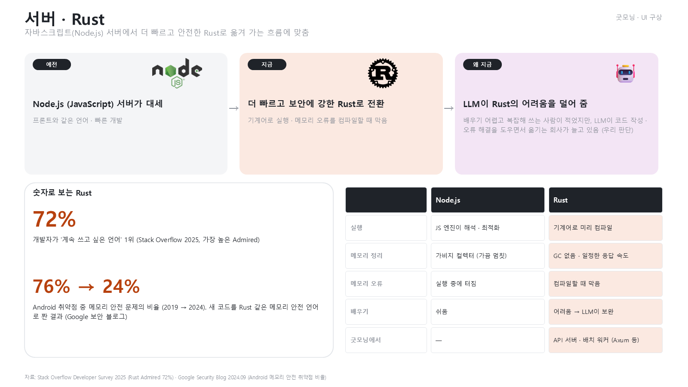

- 예전: Node.js (JavaScript) 서버가 대세 — 프론트와 같은 언어, 빠른 개발
- 지금: 더 빠르고 보안에 강한 Rust로 전환 — 기계어로 실행, 메모리 오류를 컴파일할 때 막음
- 왜 지금: LLM이 Rust의 어려움을 덜어 줌 — 배우기 어렵고 복잡해 쓰는 사람이 적었지만, LLM이 코드 작성 · 오류 해결을 도우면서 옮기는 회사가 늘고 있음 (우리 판단)

숫자로 보는 Rust

- 72%: 개발자가 계속 쓰고 싶은 언어 1위 (Stack Overflow 2025, 가장 높은 Admired)
- 76% → 24%: Android 취약점 중 메모리 안전 문제의 비율 (2019 → 2024). 새 코드를 Rust 같은 메모리 안전 언어로 짠 결과 (Google 보안 블로그)

|비교|Node.js|Rust|
|--|--|--|
|실행|JS 엔진이 해석 · 최적화|기계어로 미리 컴파일|
|메모리 정리|가비지 컬렉터 (가끔 멈칫)|GC 없음 · 일정한 응답 속도|
|메모리 오류|실행 중에 터짐|컴파일할 때 막음|
|배우기|쉬움|어려움 → LLM이 보완|
|굿모닝에서|—|API 서버 · 배치 워커 (Axum 등)|

## 36. 서버 · Rust ② — 메모리에 주인이 있다

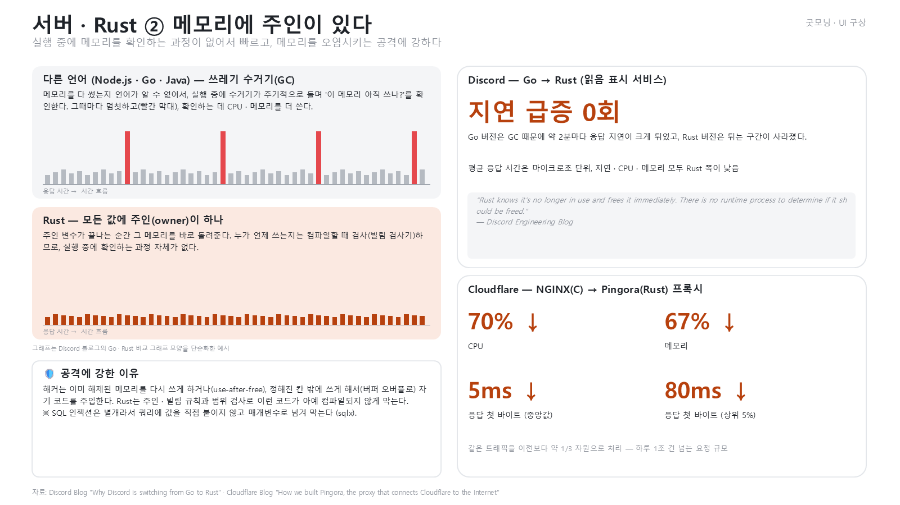

- 다른 언어 (Node.js · Go · Java) — 쓰레기 수거기(GC): 메모리를 다 썼는지 언어가 알 수 없어서, 실행 중에 수거기가 주기적으로 돌며 "이 메모리 아직 쓰나?"를 확인한다. 그때마다 멈칫하고, 확인하는 데 CPU · 메모리를 더 쓴다.
- Rust — 모든 값에 주인(owner)이 하나: 주인 변수가 끝나는 순간 그 메모리를 바로 돌려준다. 누가 언제 쓰는지는 컴파일할 때 검사(빌림 검사기)하므로, 실행 중에 확인하는 과정 자체가 없다.
- 공격에 강한 이유: 해커는 이미 해제된 메모리를 다시 쓰게 하거나(use-after-free), 정해진 칸 밖에 쓰게 해서(버퍼 오버플로) 자기 코드를 주입한다. Rust는 주인 · 빌림 규칙과 범위 검사로 이런 코드가 아예 컴파일되지 않게 막는다. SQL 인젝션은 별개라서 쿼리에 값을 직접 붙이지 않고 매개변수로 넘겨 막는다 (sqlx).

|사례|결과|
|--|--|
|Discord — Go → Rust (읽음 표시 서비스)|Go 버전은 GC 때문에 약 2분마다 응답 지연이 크게 튀었고, Rust 버전은 튀는 구간이 사라짐. 평균 응답 시간은 마이크로초 단위, 지연 · CPU · 메모리 모두 Rust 쪽이 낮음|
|Cloudflare — NGINX(C) → Pingora(Rust) 프록시|CPU 70% ↓, 메모리 67% ↓, 응답 첫 바이트 중앙값 5ms ↓, 상위 5% 80ms ↓|

> "Rust knows it's no longer in use and frees it immediately. There is no runtime process to determine if it should be freed." — Discord Engineering Blog

자료: Discord Blog "Why Discord is switching from Go to Rust" · Cloudflare Blog "How we built Pingora, the proxy that connects Cloudflare to the Internet"
