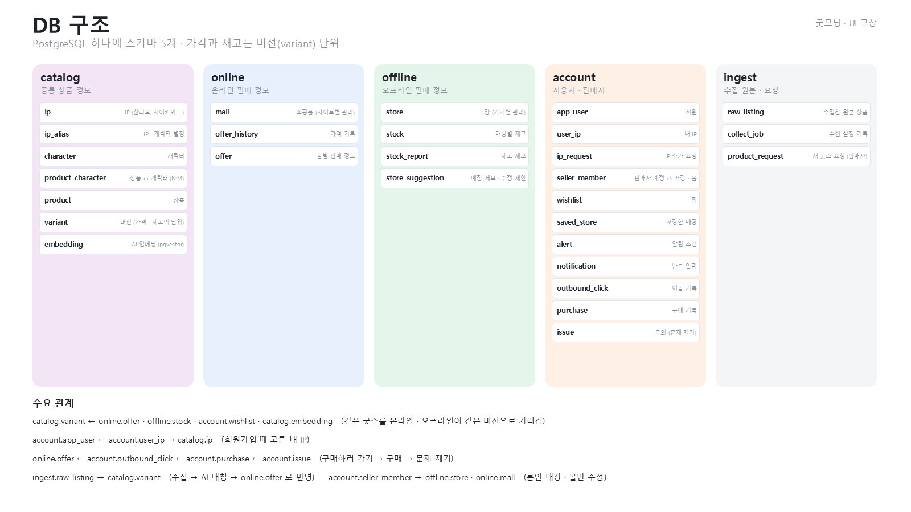
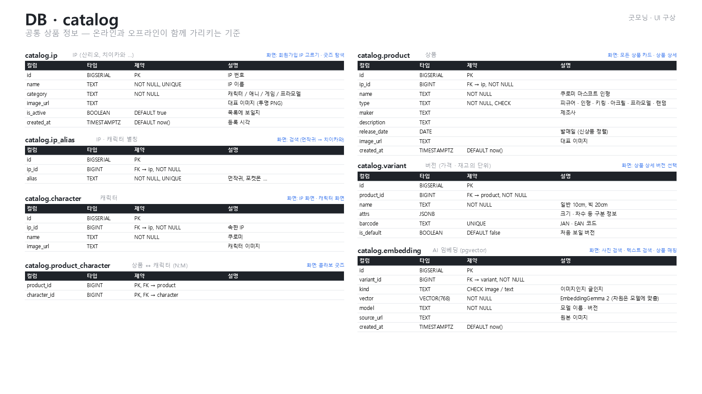
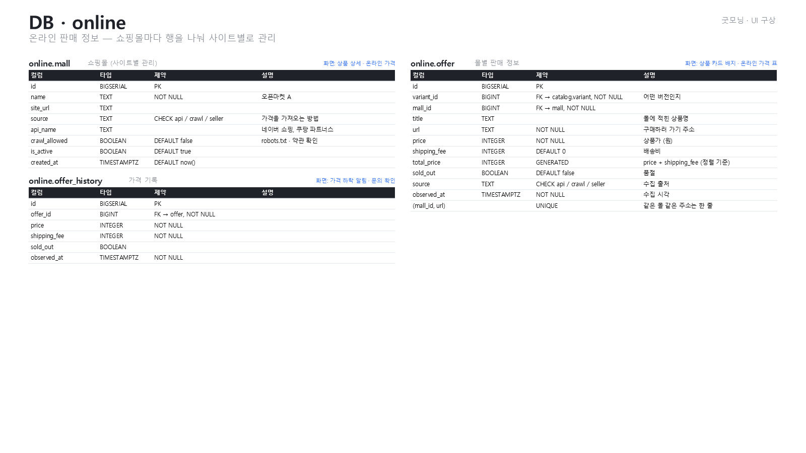
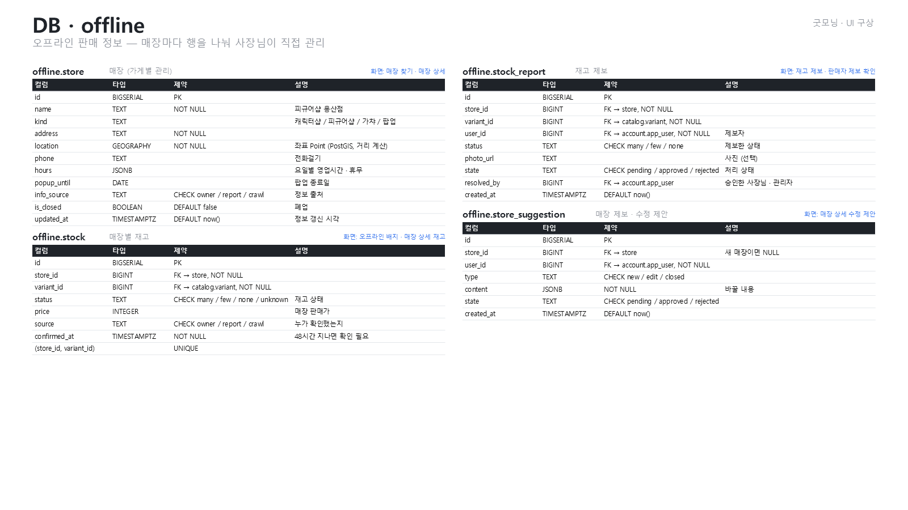
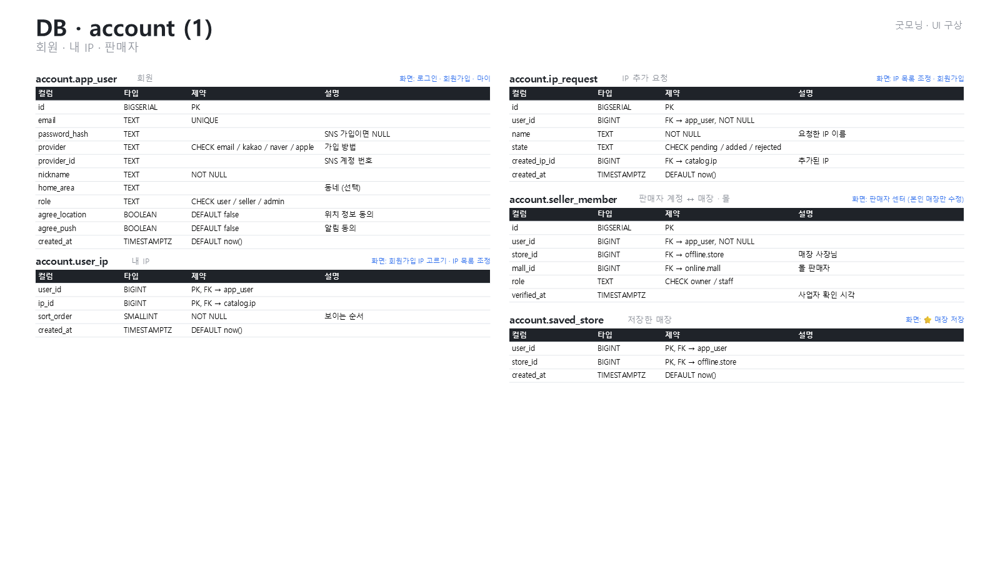
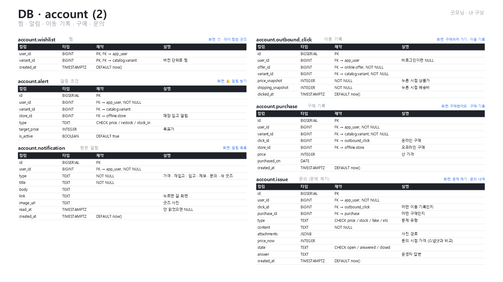
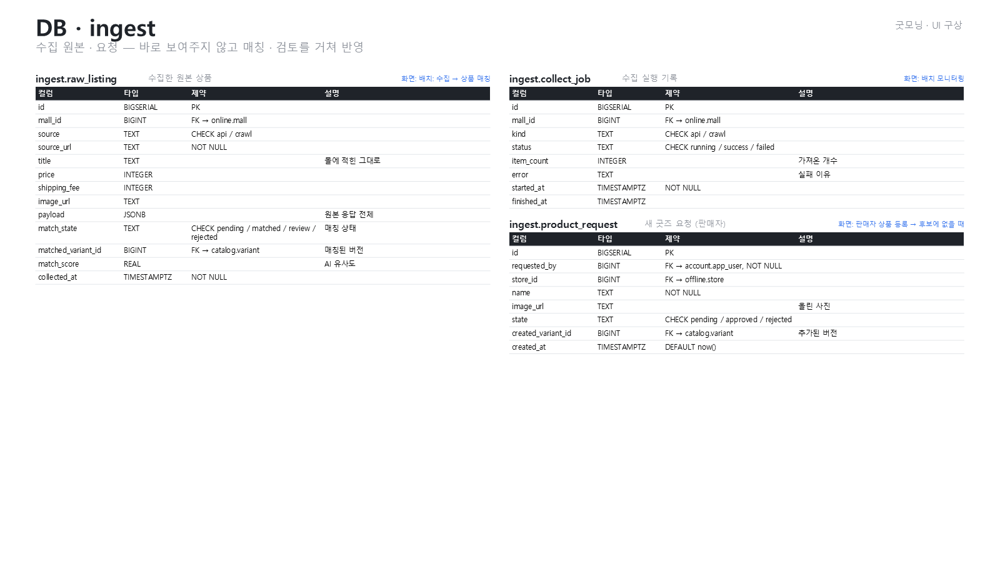

# DB 설계

> 슬라이드 37–43 · [목차](README.md)

PostgreSQL 하나에 스키마 5개. 가격과 재고는 버전(variant) 단위로 관리한다.
컬럼 · 타입 · 제약 · 설명 · 쓰는 화면은 [backend/db.md](../backend/db.md)에 모두 있다 (PPT 표와 같은 정의에서 생성).

|스키마|내용|테이블|
|--|--|--|
|`catalog`|공통 상품 정보|ip, ip_alias, character, product_character, product, variant, embedding|
|`online`|온라인 판매 정보 (쇼핑몰마다 관리)|mall, offer_history, offer|
|`offline`|오프라인 판매 정보 (매장마다 관리)|store, stock, stock_report, store_suggestion|
|`account`|사용자 · 판매자|app_user, user_ip, ip_request, seller_member, wishlist, saved_store, alert, notification, outbound_click, purchase, issue|
|`ingest`|수집 원본 · 요청|raw_listing, collect_job, product_request|

주요 관계

- `catalog.variant` ← `online.offer` · `offline.stock` · `account.wishlist` · `catalog.embedding` (같은 굿즈를 온라인 · 오프라인이 같은 버전으로 가리킴)
- `account.app_user` ← `account.user_ip` → `catalog.ip` (회원가입 때 고른 내 IP)
- `online.offer` ← `account.outbound_click` ← `account.purchase` ← `account.issue` (구매하러 가기 → 구매 → 문제 제기)
- `ingest.raw_listing` → `catalog.variant` (수집 → AI 매칭 → `online.offer`로 반영)
- `account.seller_member` → `offline.store` · `online.mall` (본인 매장 · 몰만 수정)

## 슬라이드

