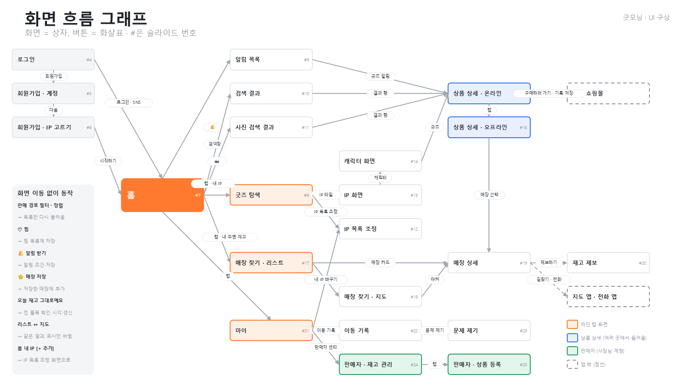

# 굿모닝 설계 문서

UI 구상 PPT (43장)를 슬라이드 이미지와 글로 옮긴 문서.
저장소에 올리는 공개용이라 캐릭터 사진은 이모지로 바꿨다. 원본 PPT(캐릭터 사진 포함)는 `design/`에 있고 저장소에는 올리지 않는다.

|문서|슬라이드|내용|
|--|--|--|
|[01 화면 흐름 · 공통 요소](01-screen-flow.md)|1–3|화면 이동 구상도, 화면 흐름 그래프, 탭 바 · 필터 · 배지 · 색 코드|
|[02 화면별 UI](02-screens.md)|4–25|로그인 · 회원가입부터 판매자 센터까지 24장, 화면마다 번호별 설명|
|[03 기술 스펙](03-tech-spec.md)|26–36|기술 스택, 크롤링, 쇼핑 API, EmbeddingGemma 2, PostgreSQL, Flutter, 미리 로딩 · 부분 로딩, 스켈레톤, Rust|
|[04 DB 설계](04-db.md)|37–43|스키마 5개 · 테이블 29개 (컬럼 정의는 [backend/db.md](../backend/db.md))|

슬라이드 이미지: `slides/slide-01.png` … `slides/slide-43.png`
